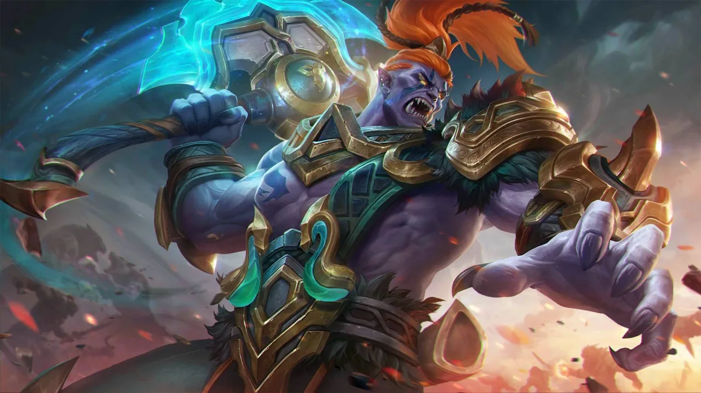
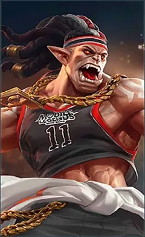

[Скины Бальмонда](https://boostmlbb.ru/skins/balmond.html)

[Скины](https://boostmlbb.ru/skins/)/[Бальмонд](https://boostmlbb.ru/skins/balmond.html)/Железношкурый берсерк

[Скин Бальмонда](https://boostmlbb.ru/skins/balmond.html)

# Железношкурый берсерк

Ironhide Berserker

Обычный CommonСезон 39Ограниченный

Как получить

Награда за рейтинговый сезон 39.

## Что меняет облик

-   Новая внешность
-   Другой цвет эффектов
-   Анимация показа
-   Бонус к характеристикам

## Все скины Бальмонда [9](https://boostmlbb.ru/skins/balmond.html)

[Бритвенный клинокИсключительный · 2025](https://boostmlbb.ru/skins/balmond/razor-edge.html)[Адский полководецДелюкс · 2023](https://boostmlbb.ru/skins/balmond/infernal-warlord.html)[БиороидИсключительный · 2022](https://boostmlbb.ru/skins/balmond/bioroid.html)[Бог горИзысканный · 2021](https://boostmlbb.ru/skins/balmond/god-of-mountains.html)[Свирепый разыгры­вающийИсключительный · 2018](https://boostmlbb.ru/skins/balmond/savage-pointguard.html)[Дикий охотникОбычный · 2017](https://boostmlbb.ru/skins/balmond/savage-hunter.html)[Ярость гуляОбычный · 2016](https://boostmlbb.ru/skins/balmond/ghoul-s-fury.html)[Источник силыОбычный · 2016](https://boostmlbb.ru/skins/balmond/power-source.html)[Желез­ношкурый берсеркОбычный](https://boostmlbb.ru/skins/balmond/ironhide-berserker.html)

**Сколько стоит буст на герое Бальмонд?**Выберите текущий и желаемый ранг. Стоимость появится на сайте.

[Рассчитать цену](https://boostmlbb.ru/order.html?type=hero)

## Частые вопросы

Как получить скин «Железношкурый берсерк» на Бальмонда?

Награда за рейтинговый сезон 39.

Какой класс у скина «Железношкурый берсерк»?

Обычный (Common), серия «Сезон 39».
