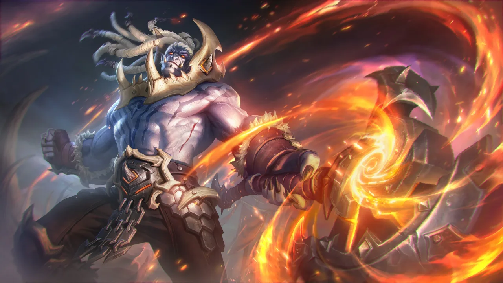

[Тир-лист](https://boostmlbb.ru/heroes/)[Предметы](https://boostmlbb.ru/items/)[Скины](https://boostmlbb.ru/skins/)[Новости и гайды](https://boostmlbb.ru/news/)

[Скины](https://boostmlbb.ru/skins/)/[Бальмонд](https://boostmlbb.ru/skins/balmond.html)/Источник силы

[Скин Бальмонда](https://boostmlbb.ru/skins/balmond.html)

# Источник силы

Power Source

Обычный CommonВ продаже

Как получить

Продаётся в магазине обликов за 269 алмазов.

Цена

269 алмазов

Вышел

2016 год

## Что меняет облик

-   Бонус к характеристикам

## Все скины Бальмонда [9](https://boostmlbb.ru/skins/balmond.html)

[Бритвенный клинокИсключительный · 2025](https://boostmlbb.ru/skins/balmond/razor-edge.html)[Адский полководецДелюкс · 2023](https://boostmlbb.ru/skins/balmond/infernal-warlord.html)[БиороидИсключительный · 2022](https://boostmlbb.ru/skins/balmond/bioroid.html)[Бог горИзысканный · 2021](https://boostmlbb.ru/skins/balmond/god-of-mountains.html)[Свирепый разыгры­вающийИсключительный · 2018](https://boostmlbb.ru/skins/balmond/savage-pointguard.html)[Дикий охотникОбычный · 2017](https://boostmlbb.ru/skins/balmond/savage-hunter.html)[Ярость гуляОбычный · 2016](https://boostmlbb.ru/skins/balmond/ghoul-s-fury.html)[Источник силыОбычный · 2016](https://boostmlbb.ru/skins/balmond/power-source.html)[Желез­ношкурый берсеркОбычный](https://boostmlbb.ru/skins/balmond/ironhide-berserker.html)

**Поднимем ранг на герое Бальмонд**Цена считается в калькуляторе

[Рассчитать цену](https://boostmlbb.ru/order.html?type=hero)

## Частые вопросы

Как получить скин «Источник силы» на Бальмонда?

Продаётся в магазине обликов за 269 алмазов.

Когда вышел скин «Источник силы»?

2016 год.

Какой класс у скина «Источник силы»?

Обычный (Common).
