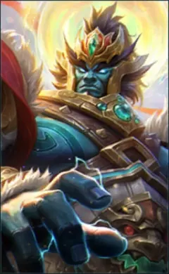

[Скины Бальмонда](https://boostmlbb.ru/skins/balmond.html)

[Скины](https://boostmlbb.ru/skins/)/[Бальмонд](https://boostmlbb.ru/skins/balmond.html)/Бритвенный клинок

[Скин Бальмонда](https://boostmlbb.ru/skins/balmond.html)

# Бритвенный клинок

Razor Edge

Исключительный ExceptionalОсобыйОграниченный

Как получить

Выходил в магазине обликов во время события. Ограниченные облики иногда возвращаются в розыгрышах событий.

Вышел

6 января 2025

## Что меняет облик

-   Новая внешность
-   Новые эффекты навыков
-   Анимация показа
-   Бонус к характеристикам

## Все скины Бальмонда [9](https://boostmlbb.ru/skins/balmond.html)

[Бритвенный клинокИсключительный · 2025](https://boostmlbb.ru/skins/balmond/razor-edge.html)[Адский полководецДелюкс · 2023](https://boostmlbb.ru/skins/balmond/infernal-warlord.html)[БиороидИсключительный · 2022](https://boostmlbb.ru/skins/balmond/bioroid.html)[Бог горИзысканный · 2021](https://boostmlbb.ru/skins/balmond/god-of-mountains.html)[Свирепый разыгры­вающийИсключительный · 2018](https://boostmlbb.ru/skins/balmond/savage-pointguard.html)[Дикий охотникОбычный · 2017](https://boostmlbb.ru/skins/balmond/savage-hunter.html)[Ярость гуляОбычный · 2016](https://boostmlbb.ru/skins/balmond/ghoul-s-fury.html)[Источник силыОбычный · 2016](https://boostmlbb.ru/skins/balmond/power-source.html)[Желез­ношкурый берсеркОбычный](https://boostmlbb.ru/skins/balmond/ironhide-berserker.html)

## Серия «Особый»

[Тайный вердиктМатильда · 2026](https://boostmlbb.ru/skins/mathilda/arcane-verdict.html)[Вальс на ветруВэйл · 2026](https://boostmlbb.ru/skins/vale/windborne-waltz.html)[Капитан потерянныхФранко · 2026](https://boostmlbb.ru/skins/franco/captain-of-the-lost.html)[ВолнорезЛи Сун-Син · 2025](https://boostmlbb.ru/skins/yi-sun-shin/wavebreaker.html)[Стальные рукиБаданг · 2025](https://boostmlbb.ru/skins/badang/steel-arms.html)[Леди с зонтикомКагура · 2025](https://boostmlbb.ru/skins/kagura/lady-parasol.html)[Ужас пучиныАлдос · 2025](https://boostmlbb.ru/skins/aldous/fathom-terror.html)[Труппа лунного светаЧан'Э · 2025](https://boostmlbb.ru/skins/change/moonglow-troupe.html)

**Сколько стоит буст на герое Бальмонд?**Выберите текущий и желаемый ранг. Стоимость появится на сайте.

[Рассчитать цену](https://boostmlbb.ru/order.html?type=hero)

## Частые вопросы

Как получить скин «Бритвенный клинок» на Бальмонда?

Выходил в магазине обликов во время события. Ограниченные облики иногда возвращаются в розыгрышах событий.

Когда вышел скин «Бритвенный клинок»?

6 января 2025.

Какой класс у скина «Бритвенный клинок»?

Исключительный (Exceptional), серия «Особый».
