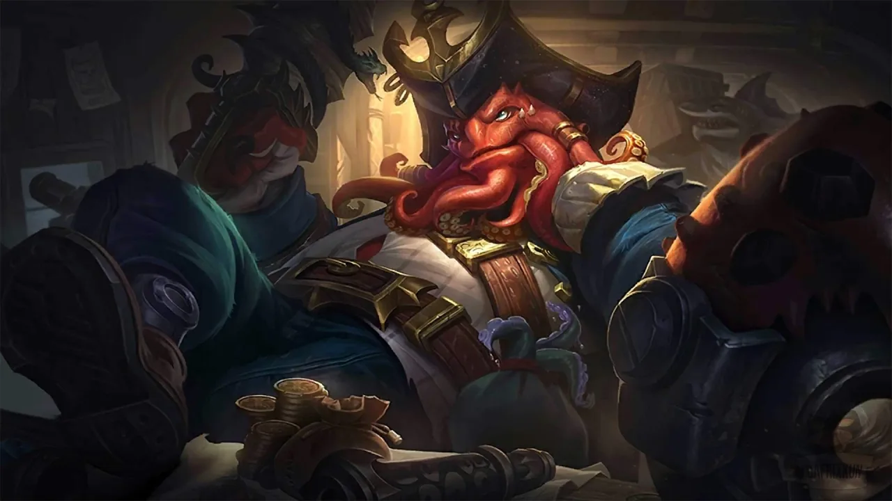
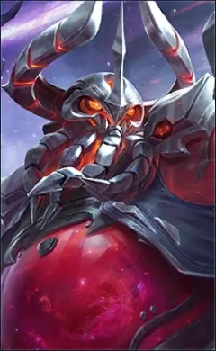

[Тир-лист](https://boostmlbb.ru/heroes/)[Предметы](https://boostmlbb.ru/items/)[Скины](https://boostmlbb.ru/skins/)[Новости и гайды](https://boostmlbb.ru/news/)

[Скины](https://boostmlbb.ru/skins/)/Бэйн

# Скины Бэйна

Скинов

6

Можно купить

2

Последний

[Владыка кипящих морей](https://boostmlbb.ru/skins/bane/lord-of-scalding-seas.html)2025

[Профиль героя→](https://boostmlbb.ru/heroes/bane.html)

## Все скины

[Владыка кипящих морейИсключительный · 2025](https://boostmlbb.ru/skins/bane/lord-of-scalding-seas.html)[Осквер­нитель душДелюкс · 2023](https://boostmlbb.ru/skins/bane/soul-defiler.html)[Изгой подземного мираОбычный · 2022](https://boostmlbb.ru/skins/bane/underworld-outlaw.html)[Воена­чальникОбычный · 2019](https://boostmlbb.ru/skins/bane/warlord.html)[Чудовище глубинОбычный · 2018](https://boostmlbb.ru/skins/bane/deep-sea-monster.html)[Хозяин замкаДелюкс · 2016](https://boostmlbb.ru/skins/bane/castle-master.html)

**Поднимем ранг на герое Бэйн**Цена считается в калькуляторе

[Рассчитать цену](https://boostmlbb.ru/order.html?type=hero)

## Частые вопросы

Сколько скинов у Бэйна?

6 скинов без стандартного облика. Последний — «Владыка кипящих морей» (Lord of Scalding Seas), 1 ноября 2025.

Какие скины Бэйна можно купить сейчас?

«Осквернитель душ» (899 алмазов), «Чудовище глубин» (269 алмазов). Остальные облики ограниченные и возвращаются только в событиях.

Какой самый редкий скин Бэйна?

«Осквернитель душ» (Soul Defiler), класс делюкс, серия «Эпический». Продаётся в магазине обликов за 899 алмазов.
