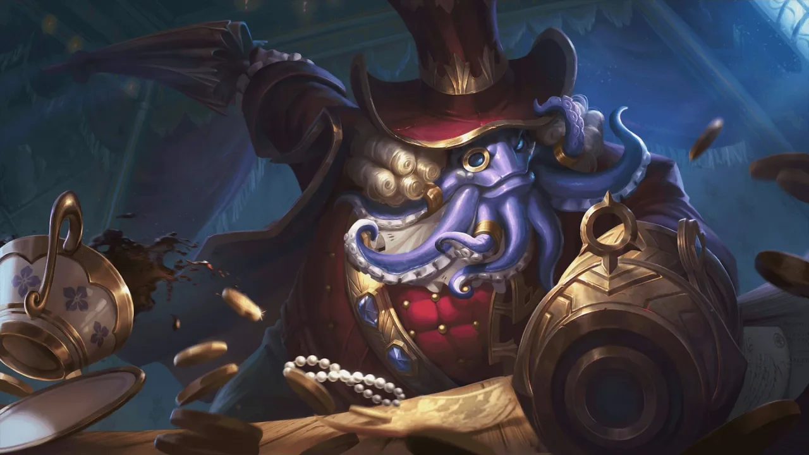

[Скины Бэйна](https://boostmlbb.ru/skins/bane.html)

[Скины](https://boostmlbb.ru/skins/)/[Бэйн](https://boostmlbb.ru/skins/bane.html)/Хозяин замка

[Скин Бэйна](https://boostmlbb.ru/skins/bane.html)

# Хозяин замка

Castle Master

Делюкс DeluxeЭпическийОграниченный

Как получить

Выходил в магазине обликов во время события. Ограниченные облики иногда возвращаются в розыгрышах событий.

Вышел

2016 год

## Что меняет облик

-   Новая внешность
-   Новые эффекты навыков
-   Звуки навыков
-   Своя озвучка
-   Анимация показа
-   Сцена показа
-   Бонус к характеристикам

## Все скины Бэйна [6](https://boostmlbb.ru/skins/bane.html)

[Владыка кипящих морейИсключительный · 2025](https://boostmlbb.ru/skins/bane/lord-of-scalding-seas.html)[Осквер­нитель душДелюкс · 2023](https://boostmlbb.ru/skins/bane/soul-defiler.html)[Изгой подземного мираОбычный · 2022](https://boostmlbb.ru/skins/bane/underworld-outlaw.html)[Воена­чальникОбычный · 2019](https://boostmlbb.ru/skins/bane/warlord.html)[Чудовище глубинОбычный · 2018](https://boostmlbb.ru/skins/bane/deep-sea-monster.html)[Хозяин замкаДелюкс · 2016](https://boostmlbb.ru/skins/bane/castle-master.html)

## Серия «Эпический»

[Надзи­ратель преис­поднейМинотавр · 2026](https://boostmlbb.ru/skins/minotaur/nether-overseer.html)[Затонувшее проклятиеАтлас · 2026](https://boostmlbb.ru/skins/atlas/sunken-curse.html)[Вечная клятваВексана · 2026](https://boostmlbb.ru/skins/vexana/eternal-vow.html)[Проклятый свитокХуфра · 2025](https://boostmlbb.ru/skins/khufra/cursed-scroll.html)[Охотница за душамиНаталья · 2025](https://boostmlbb.ru/skins/natalia/soul-huntress.html)[Граф кошмаровЛеоморд · 2025](https://boostmlbb.ru/skins/leomord/nightmare-count.html)[Вершитель звёздБелерик · 2025](https://boostmlbb.ru/skins/belerick/arbiter-of-stars.html)[Хранитель ветровВэйл · 2025](https://boostmlbb.ru/skins/vale/keeper-of-the-winds.html)

**Сколько стоит буст на герое Бэйн?**Выберите текущий и желаемый ранг. Стоимость появится на сайте.

[Рассчитать цену](https://boostmlbb.ru/order.html?type=hero)

## Частые вопросы

Как получить скин «Хозяин замка» на Бэйна?

Выходил в магазине обликов во время события. Ограниченные облики иногда возвращаются в розыгрышах событий.

Когда вышел скин «Хозяин замка»?

2016 год.

Какой класс у скина «Хозяин замка»?

Делюкс (Deluxe), серия «Эпический».
