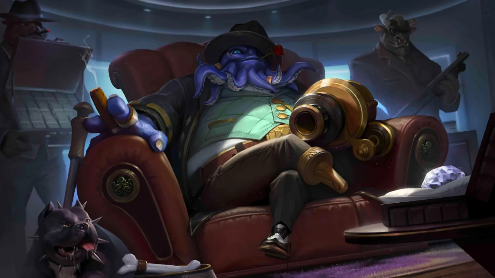
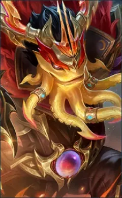
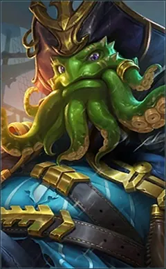

[Тир-лист](https://boostmlbb.ru/heroes/)[Предметы](https://boostmlbb.ru/items/)[Скины](https://boostmlbb.ru/skins/)[Новости и гайды](https://boostmlbb.ru/news/)

[Скины](https://boostmlbb.ru/skins/)/[Бэйн](https://boostmlbb.ru/skins/bane.html)/Изгой подземного мира

[Скин Бэйна](https://boostmlbb.ru/skins/bane.html)

# Изгой подземного мира

Underworld Outlaw

Обычный CommonЭлитныйОграниченный

Как получить

Подарок за первое пополнение в сезоне 24.

Вышел

2022 год

## Что меняет облик

-   Новая внешность
-   Бонус к характеристикам

## Все скины Бэйна [6](https://boostmlbb.ru/skins/bane.html)

[Владыка кипящих морейИсключительный · 2025](https://boostmlbb.ru/skins/bane/lord-of-scalding-seas.html)[Осквер­нитель душДелюкс · 2023](https://boostmlbb.ru/skins/bane/soul-defiler.html)[Изгой подземного мираОбычный · 2022](https://boostmlbb.ru/skins/bane/underworld-outlaw.html)[Воена­чальникОбычный · 2019](https://boostmlbb.ru/skins/bane/warlord.html)[Чудовище глубинОбычный · 2018](https://boostmlbb.ru/skins/bane/deep-sea-monster.html)[Хозяин замкаДелюкс · 2016](https://boostmlbb.ru/skins/bane/castle-master.html)

## Серия «Элитный»

[Золотой османтусЧан'Э · 2026](https://boostmlbb.ru/skins/change/golden-osmanthus.html)[Король-воена­чальникМартис · 2025](https://boostmlbb.ru/skins/martis/warlord-king.html)[Кадет открытого моряКимми · 2024](https://boostmlbb.ru/skins/kimmy/high-seas-cadet.html)[Зелёная копейщицаСильвана · 2024](https://boostmlbb.ru/skins/silvanna/verdant-lancer.html)[Мародёр Кровавое КопытоХилос · 2024](https://boostmlbb.ru/skins/hylos/bloodhoof-marauder.html)[Изящная бабочкаГвиневра · 2024](https://boostmlbb.ru/skins/guinevere/elegant-butterfly.html)[Маркиз клинковЛанселот · 2024](https://boostmlbb.ru/skins/lancelot/marques-of-blades.html)[Привал в пустошахЧип · 2024](https://boostmlbb.ru/skins/chip/badlands-hiatus.html)

**Поднимем ранг на герое Бэйн**Цена считается в калькуляторе

[Рассчитать цену](https://boostmlbb.ru/order.html?type=hero)

## Частые вопросы

Как получить скин «Изгой подземного мира» на Бэйна?

Подарок за первое пополнение в сезоне 24.

Когда вышел скин «Изгой подземного мира»?

2022 год.

Какой класс у скина «Изгой подземного мира»?

Обычный (Common), серия «Элитный».
