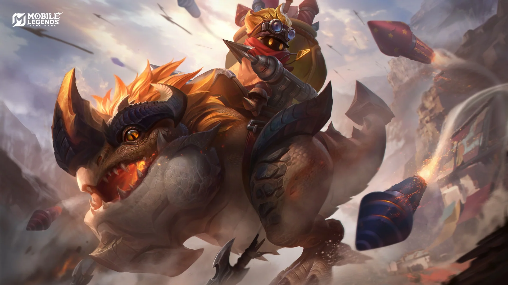
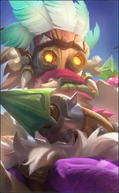
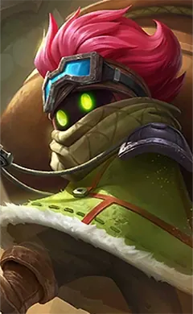

[Тир-лист](https://boostmlbb.ru/heroes/)[Предметы](https://boostmlbb.ru/items/)[Скины](https://boostmlbb.ru/skins/)[Новости и гайды](https://boostmlbb.ru/news/)

[Скины](https://boostmlbb.ru/skins/)/Бартс

# Скины Бартса

Скинов

5

Можно купить

4

Последний

[Затонувший хищник](https://boostmlbb.ru/skins/barats/sunken-predator.html)2025

[Профиль героя→](https://boostmlbb.ru/heroes/barats.html)

## Все скины

[Затонувший хищникДелюкс · 2025](https://boostmlbb.ru/skins/barats/sunken-predator.html)[ВождьОбычный · 2022](https://boostmlbb.ru/skins/barats/war-chief.html)[БартсштейнИсключительный · 2021](https://boostmlbb.ru/skins/barats/baratstein.html)[Игрушечный рексОбычный · 2021](https://boostmlbb.ru/skins/barats/toy-rex.html)[Брониро­ванный ящерОбычный · 2020](https://boostmlbb.ru/skins/barats/armored-lizard.html)

**Поднимем ранг на герое Бартс**Цена считается в калькуляторе

[Рассчитать цену](https://boostmlbb.ru/order.html?type=hero)

## Частые вопросы

Сколько скинов у Бартса?

5 скинов без стандартного облика. Последний — «Затонувший хищник» (Sunken Predator), 10 февраля 2025.

Какие скины Бартса можно купить сейчас?

«Затонувший хищник» (899 алмазов), «Бартсштейн» (749 алмазов), «Игрушечный рекс» (599 алмазов), «Бронированный ящер» (269 алмазов). Остальные облики ограниченные и возвращаются только в событиях.

Какой самый редкий скин Бартса?

«Затонувший хищник» (Sunken Predator), класс делюкс, серия «Эпический». Продаётся в магазине обликов за 899 алмазов.
