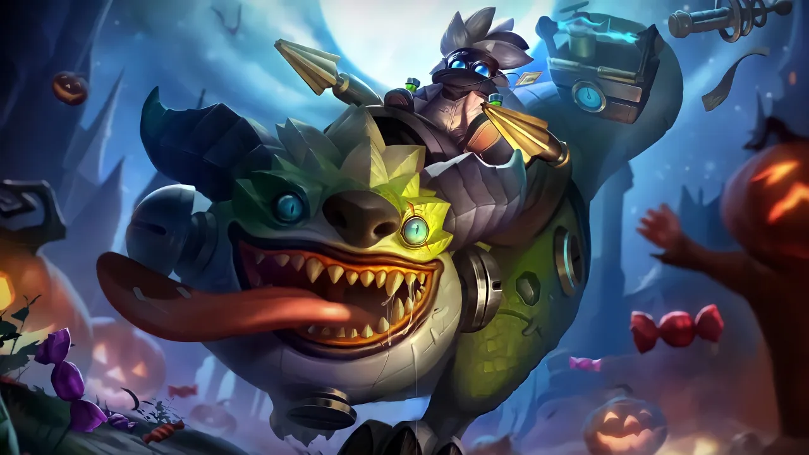

[Тир-лист](https://boostmlbb.ru/heroes/)[Предметы](https://boostmlbb.ru/items/)[Скины](https://boostmlbb.ru/skins/)[Новости и гайды](https://boostmlbb.ru/news/)

[Скины](https://boostmlbb.ru/skins/)/[Бартс](https://boostmlbb.ru/skins/barats.html)/Бартсштейн

[Скин Бартса](https://boostmlbb.ru/skins/barats.html)

# Бартсштейн

Baratstein

Исключительный ExceptionalХэллоуинВ продаже

Как получить

Продаётся в магазине обликов за 749 алмазов.

Цена

749 алмазов

Вышел

30 октября 2021

## Что меняет облик

-   Новая внешность
-   Новые эффекты навыков
-   Анимация показа
-   Сцена показа
-   Бонус к характеристикам

## Все скины Бартса [5](https://boostmlbb.ru/skins/barats.html)

[Затонувший хищникДелюкс · 2025](https://boostmlbb.ru/skins/barats/sunken-predator.html)[ВождьОбычный · 2022](https://boostmlbb.ru/skins/barats/war-chief.html)[БартсштейнИсключительный · 2021](https://boostmlbb.ru/skins/barats/baratstein.html)[Игрушечный рексОбычный · 2021](https://boostmlbb.ru/skins/barats/toy-rex.html)[Брониро­ванный ящерОбычный · 2020](https://boostmlbb.ru/skins/barats/armored-lizard.html)

## Серия «Хэллоуин»

[Тыквенный драчунАкай · 2023](https://boostmlbb.ru/skins/akai/pumpkin-brawler.html)[Соломенная куклаЦиклоп · 2021](https://boostmlbb.ru/skins/cyclops/straw-doll.html)[Светильник ДжекаЛеоморд · 2020](https://boostmlbb.ru/skins/leomord/jack-o-lantern.html)[Проклятая куклаЛилия · 2020](https://boostmlbb.ru/skins/lylia/haunted-doll.html)[Кричащая куклаАнгела · 2019](https://boostmlbb.ru/skins/angela/scream-doll.html)[Кошмар пшеничного поляФранко · 2019](https://boostmlbb.ru/skins/franco/wheatfield-nightmare.html)[ШутихаКэрри · 2018](https://boostmlbb.ru/skins/karrie/jester.html)[ПроказницаЛолита · 2017](https://boostmlbb.ru/skins/lolita/impish-trickster.html)

**Поднимем ранг на герое Бартс**Цена считается в калькуляторе

[Рассчитать цену](https://boostmlbb.ru/order.html?type=hero)

## Частые вопросы

Как получить скин «Бартсштейн» на Бартса?

Продаётся в магазине обликов за 749 алмазов.

Когда вышел скин «Бартсштейн»?

30 октября 2021.

Какой класс у скина «Бартсштейн»?

Исключительный (Exceptional), серия «Хэллоуин».
