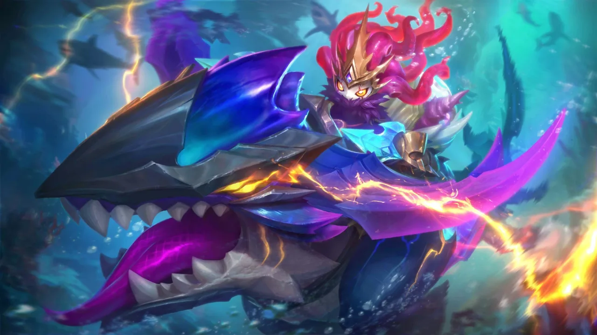
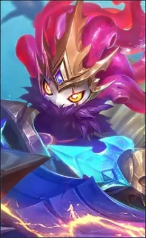

[Тир-лист](https://boostmlbb.ru/heroes/)[Предметы](https://boostmlbb.ru/items/)[Скины](https://boostmlbb.ru/skins/)[Новости и гайды](https://boostmlbb.ru/news/)

[Скины](https://boostmlbb.ru/skins/)/[Бартс](https://boostmlbb.ru/skins/barats.html)/Затонувший хищник

[Скин Бартса](https://boostmlbb.ru/skins/barats.html)

# Затонувший хищник

Sunken Predator

Делюкс DeluxeЭпическийВ продаже

Как получить

Продаётся в магазине обликов за 899 алмазов.

Цена

899 алмазов

Вышел

10 февраля 2025

## Что меняет облик

-   Новая внешность
-   Новые эффекты навыков
-   Звуки навыков
-   Анимация показа
-   Сцена показа
-   Музыка показа
-   Бонус к характеристикам

## Все скины Бартса [5](https://boostmlbb.ru/skins/barats.html)

[Затонувший хищникДелюкс · 2025](https://boostmlbb.ru/skins/barats/sunken-predator.html)[ВождьОбычный · 2022](https://boostmlbb.ru/skins/barats/war-chief.html)[БартсштейнИсключительный · 2021](https://boostmlbb.ru/skins/barats/baratstein.html)[Игрушечный рексОбычный · 2021](https://boostmlbb.ru/skins/barats/toy-rex.html)[Брониро­ванный ящерОбычный · 2020](https://boostmlbb.ru/skins/barats/armored-lizard.html)

## Серия «Эпический»

[Надзи­ратель преис­поднейМинотавр · 2026](https://boostmlbb.ru/skins/minotaur/nether-overseer.html)[Затонувшее проклятиеАтлас · 2026](https://boostmlbb.ru/skins/atlas/sunken-curse.html)[Вечная клятваВексана · 2026](https://boostmlbb.ru/skins/vexana/eternal-vow.html)[Проклятый свитокХуфра · 2025](https://boostmlbb.ru/skins/khufra/cursed-scroll.html)[Охотница за душамиНаталья · 2025](https://boostmlbb.ru/skins/natalia/soul-huntress.html)[Граф кошмаровЛеоморд · 2025](https://boostmlbb.ru/skins/leomord/nightmare-count.html)[Вершитель звёздБелерик · 2025](https://boostmlbb.ru/skins/belerick/arbiter-of-stars.html)[Хранитель ветровВэйл · 2025](https://boostmlbb.ru/skins/vale/keeper-of-the-winds.html)

**Поднимем ранг на герое Бартс**Цена считается в калькуляторе

[Рассчитать цену](https://boostmlbb.ru/order.html?type=hero)

## Частые вопросы

Как получить скин «Затонувший хищник» на Бартса?

Продаётся в магазине обликов за 899 алмазов.

Когда вышел скин «Затонувший хищник»?

10 февраля 2025.

Какой класс у скина «Затонувший хищник»?

Делюкс (Deluxe), серия «Эпический».
