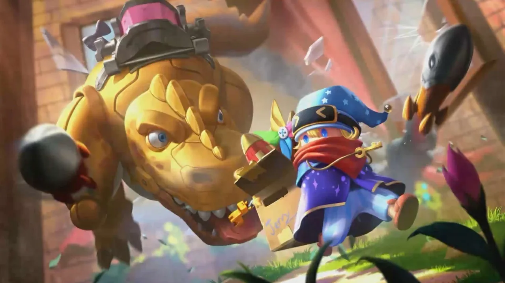

[Тир-лист](https://boostmlbb.ru/heroes/)[Предметы](https://boostmlbb.ru/items/)[Скины](https://boostmlbb.ru/skins/)[Новости и гайды](https://boostmlbb.ru/news/)

[Скины](https://boostmlbb.ru/skins/)/[Бартс](https://boostmlbb.ru/skins/barats.html)/Игрушечный рекс

[Скин Бартса](https://boostmlbb.ru/skins/barats.html)

# Игрушечный рекс

Toy Rex

Обычный CommonЭлитныйВ продаже

Как получить

Продаётся в магазине обликов за 599 алмазов.

Цена

599 алмазов

Вышел

10 апреля 2021

## Что меняет облик

-   Новая внешность
-   Другой цвет эффектов
-   Анимация показа
-   Бонус к характеристикам

## Все скины Бартса [5](https://boostmlbb.ru/skins/barats.html)

[Затонувший хищникДелюкс · 2025](https://boostmlbb.ru/skins/barats/sunken-predator.html)[ВождьОбычный · 2022](https://boostmlbb.ru/skins/barats/war-chief.html)[БартсштейнИсключительный · 2021](https://boostmlbb.ru/skins/barats/baratstein.html)[Игрушечный рексОбычный · 2021](https://boostmlbb.ru/skins/barats/toy-rex.html)[Брониро­ванный ящерОбычный · 2020](https://boostmlbb.ru/skins/barats/armored-lizard.html)

## Серия «Элитный»

[Золотой османтусЧан'Э · 2026](https://boostmlbb.ru/skins/change/golden-osmanthus.html)[Король-воена­чальникМартис · 2025](https://boostmlbb.ru/skins/martis/warlord-king.html)[Кадет открытого моряКимми · 2024](https://boostmlbb.ru/skins/kimmy/high-seas-cadet.html)[Зелёная копейщицаСильвана · 2024](https://boostmlbb.ru/skins/silvanna/verdant-lancer.html)[Мародёр Кровавое КопытоХилос · 2024](https://boostmlbb.ru/skins/hylos/bloodhoof-marauder.html)[Изящная бабочкаГвиневра · 2024](https://boostmlbb.ru/skins/guinevere/elegant-butterfly.html)[Маркиз клинковЛанселот · 2024](https://boostmlbb.ru/skins/lancelot/marques-of-blades.html)[Привал в пустошахЧип · 2024](https://boostmlbb.ru/skins/chip/badlands-hiatus.html)

**Поднимем ранг на герое Бартс**Цена считается в калькуляторе

[Рассчитать цену](https://boostmlbb.ru/order.html?type=hero)

## Частые вопросы

Как получить скин «Игрушечный рекс» на Бартса?

Продаётся в магазине обликов за 599 алмазов.

Когда вышел скин «Игрушечный рекс»?

10 апреля 2021.

Какой класс у скина «Игрушечный рекс»?

Обычный (Common), серия «Элитный».
