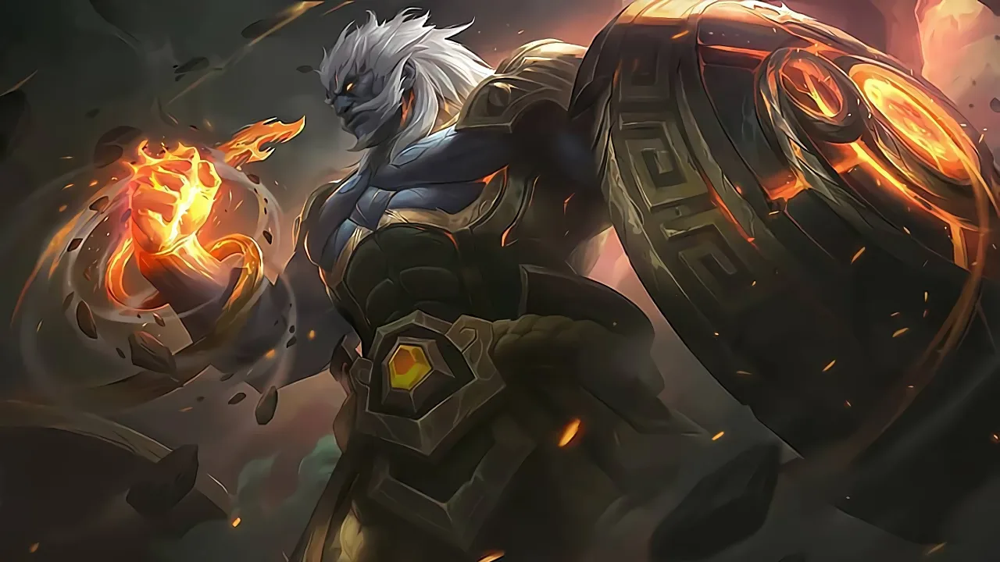
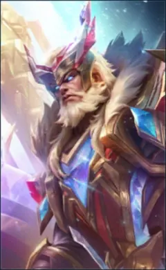

[Все скины](https://boostmlbb.ru/skins/)

[Скины](https://boostmlbb.ru/skins/)/Баксий

# Скины Баксия

Скинов

6

Можно купить

3

Последний

[Бесстрашный щит](https://boostmlbb.ru/skins/baxia/dauntless-shield.html)2024

[Профиль героя→](https://boostmlbb.ru/heroes/baxia.html)

## Все скины

[Бесстрашный щитИсключительный · 2024](https://boostmlbb.ru/skins/baxia/dauntless-shield.html)[Чёрная черепахаОбычный · 2023](https://boostmlbb.ru/skins/baxia/black-tortoise.html)[Ба-рменИсключительный · 2021](https://boostmlbb.ru/skins/baxia/ba-tender.html)[Крутой роллерОбычный · 2020](https://boostmlbb.ru/skins/baxia/badass-roller.html)[Дикий тотемОбычный · 2019](https://boostmlbb.ru/skins/baxia/wild-totem.html)[Эгида чести](https://boostmlbb.ru/skins/baxia/aegis-of-honor.html)

**Сколько стоит буст на герое Баксий?**Выберите текущий и желаемый ранг. Стоимость появится на сайте.

[Рассчитать цену](https://boostmlbb.ru/order.html?type=hero)

## Частые вопросы

Сколько скинов у Баксия?

6 скинов без стандартного облика. Последний — «Бесстрашный щит» (Dauntless Shield), 18 ноября 2024.

Какие скины Баксия можно купить сейчас?

«Ба-рмен» (749 алмазов), «Крутой роллер» (599 алмазов), «Дикий тотем» (269 алмазов). Остальные облики ограниченные и возвращаются только в событиях.

Какой самый редкий скин Баксия?

«Бесстрашный щит» (Dauntless Shield), класс исключительный, серия «Особый». Награда пропуска M6.
