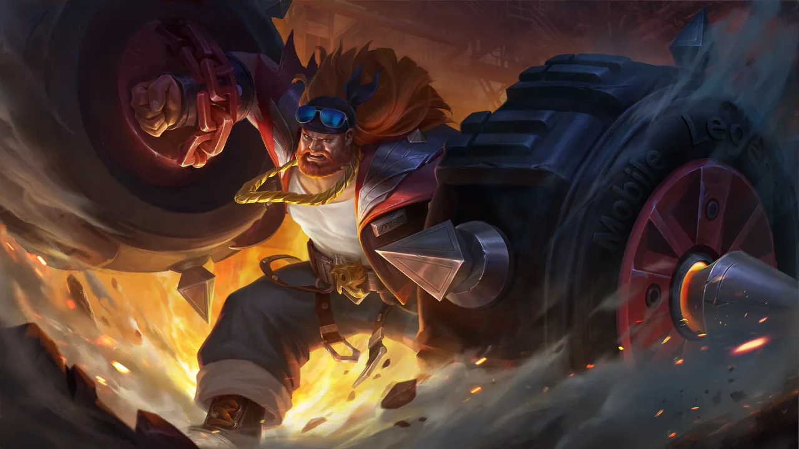

[Скины Баксия](https://boostmlbb.ru/skins/baxia.html)

[Скины](https://boostmlbb.ru/skins/)/[Баксий](https://boostmlbb.ru/skins/baxia.html)/Крутой роллер

[Скин Баксия](https://boostmlbb.ru/skins/baxia.html)

# Крутой роллер

Badass Roller

Обычный CommonЭлитныйВ продаже

Как получить

Продаётся в магазине обликов за 599 алмазов.

Цена

599 алмазов

Вышел

июль 2020

## Что меняет облик

-   Новая внешность
-   Другой цвет эффектов
-   Анимация показа
-   Бонус к характеристикам

## Все скины Баксия [6](https://boostmlbb.ru/skins/baxia.html)

[Бесстрашный щитИсключительный · 2024](https://boostmlbb.ru/skins/baxia/dauntless-shield.html)[Чёрная черепахаОбычный · 2023](https://boostmlbb.ru/skins/baxia/black-tortoise.html)[Ба-рменИсключительный · 2021](https://boostmlbb.ru/skins/baxia/ba-tender.html)[Крутой роллерОбычный · 2020](https://boostmlbb.ru/skins/baxia/badass-roller.html)[Дикий тотемОбычный · 2019](https://boostmlbb.ru/skins/baxia/wild-totem.html)[Эгида чести](https://boostmlbb.ru/skins/baxia/aegis-of-honor.html)

## Серия «Элитный»

[Золотой османтусЧан'Э · 2026](https://boostmlbb.ru/skins/change/golden-osmanthus.html)[Король-воена­чальникМартис · 2025](https://boostmlbb.ru/skins/martis/warlord-king.html)[Кадет открытого моряКимми · 2024](https://boostmlbb.ru/skins/kimmy/high-seas-cadet.html)[Зелёная копейщицаСильвана · 2024](https://boostmlbb.ru/skins/silvanna/verdant-lancer.html)[Мародёр Кровавое КопытоХилос · 2024](https://boostmlbb.ru/skins/hylos/bloodhoof-marauder.html)[Изящная бабочкаГвиневра · 2024](https://boostmlbb.ru/skins/guinevere/elegant-butterfly.html)[Маркиз клинковЛанселот · 2024](https://boostmlbb.ru/skins/lancelot/marques-of-blades.html)[Привал в пустошахЧип · 2024](https://boostmlbb.ru/skins/chip/badlands-hiatus.html)

**Сколько стоит буст на герое Баксий?**Выберите текущий и желаемый ранг. Стоимость появится на сайте.

[Рассчитать цену](https://boostmlbb.ru/order.html?type=hero)

## Частые вопросы

Как получить скин «Крутой роллер» на Баксия?

Продаётся в магазине обликов за 599 алмазов.

Когда вышел скин «Крутой роллер»?

Июль 2020.

Какой класс у скина «Крутой роллер»?

Обычный (Common), серия «Элитный».
