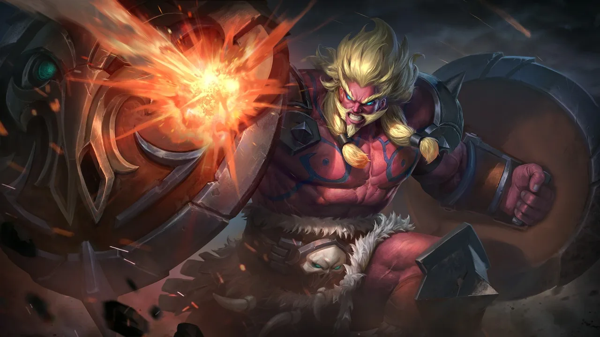
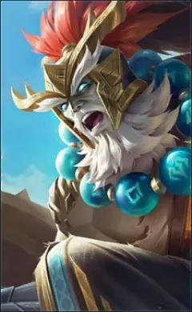

[Тир-лист](https://boostmlbb.ru/heroes/)[Предметы](https://boostmlbb.ru/items/)[Скины](https://boostmlbb.ru/skins/)[Новости и гайды](https://boostmlbb.ru/news/)

[Скины](https://boostmlbb.ru/skins/)/[Баксий](https://boostmlbb.ru/skins/baxia.html)/Дикий тотем

[Скин Баксия](https://boostmlbb.ru/skins/baxia.html)

# Дикий тотем

Wild Totem

Обычный CommonВ продаже

Как получить

Продаётся в магазине обликов за 269 алмазов.

Цена

269 алмазов

Вышел

8 октября 2019

## Что меняет облик

-   Бонус к характеристикам

## Все скины Баксия [6](https://boostmlbb.ru/skins/baxia.html)

[Бесстрашный щитИсключительный · 2024](https://boostmlbb.ru/skins/baxia/dauntless-shield.html)[Чёрная черепахаОбычный · 2023](https://boostmlbb.ru/skins/baxia/black-tortoise.html)[Ба-рменИсключительный · 2021](https://boostmlbb.ru/skins/baxia/ba-tender.html)[Крутой роллерОбычный · 2020](https://boostmlbb.ru/skins/baxia/badass-roller.html)[Дикий тотемОбычный · 2019](https://boostmlbb.ru/skins/baxia/wild-totem.html)[Эгида чести](https://boostmlbb.ru/skins/baxia/aegis-of-honor.html)

**Поднимем ранг на герое Баксий**Цена считается в калькуляторе

[Рассчитать цену](https://boostmlbb.ru/order.html?type=hero)

## Частые вопросы

Как получить скин «Дикий тотем» на Баксия?

Продаётся в магазине обликов за 269 алмазов.

Когда вышел скин «Дикий тотем»?

8 октября 2019.

Какой класс у скина «Дикий тотем»?

Обычный (Common).
