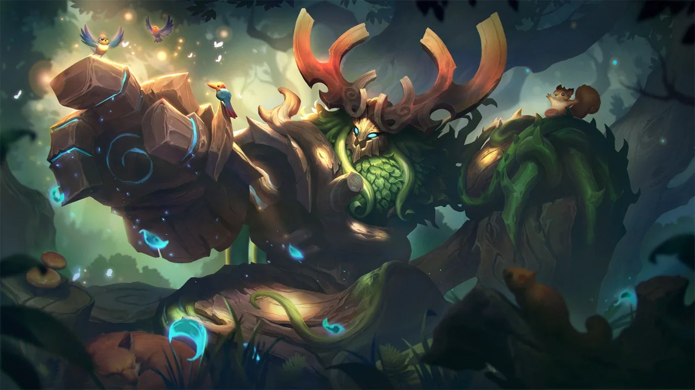

[Все скины](https://boostmlbb.ru/skins/)

[Скины](https://boostmlbb.ru/skins/)/Белерик

# Скины Белерика

Скинов

6

Можно купить

3

Последний

[Тлеющая крепость](https://boostmlbb.ru/skins/belerick/smouldering-fortress.html)2026

[Профиль героя→](https://boostmlbb.ru/heroes/belerick.html)

## Все скины

[Тлеющая крепостьИсключительный · 2026](https://boostmlbb.ru/skins/belerick/smouldering-fortress.html)[Вершитель звёздДелюкс · 2025](https://boostmlbb.ru/skins/belerick/arbiter-of-stars.html)[Тигриный коготьОбычный · 2022](https://boostmlbb.ru/skins/belerick/tiger-s-claw.html)[Страж факелаОбычный · 2019](https://boostmlbb.ru/skins/belerick/torch-guardian.html)[Изумрудный стражИсключительный · 2018](https://boostmlbb.ru/skins/belerick/emerald-guardian.html)[Глубоко­водныйИсключительный · 2018](https://boostmlbb.ru/skins/belerick/the-deep-one.html)

**Сколько стоит буст на герое Белерик?**Выберите текущий и желаемый ранг. Стоимость появится на сайте.

[Рассчитать цену](https://boostmlbb.ru/order.html?type=hero)

## Частые вопросы

Сколько скинов у Белерика?

6 скинов без стандартного облика. Последний — «Тлеющая крепость» (Smouldering Fortress), 1 июля 2026.

Какие скины Белерика можно купить сейчас?

«Вершитель звёзд» (899 алмазов), «Тигриный коготь» (269 алмазов), «Глубоководный» (749 алмазов). Остальные облики ограниченные и возвращаются только в событиях.

Какой самый редкий скин Белерика?

«Вершитель звёзд» (Arbiter of Stars), класс делюкс, серия «Эпический». Продаётся в магазине обликов за 899 алмазов.
