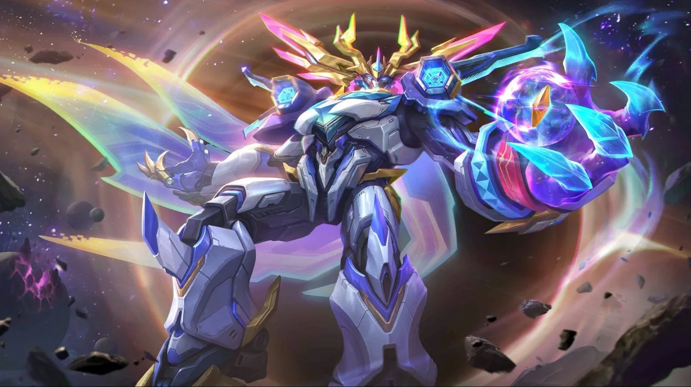

[Тир-лист](https://boostmlbb.ru/heroes/)[Предметы](https://boostmlbb.ru/items/)[Скины](https://boostmlbb.ru/skins/)[Новости и гайды](https://boostmlbb.ru/news/)

[Скины](https://boostmlbb.ru/skins/)/[Белерик](https://boostmlbb.ru/skins/belerick.html)/Вершитель звёзд

[Скин Белерика](https://boostmlbb.ru/skins/belerick.html)

# Вершитель звёзд

Arbiter of Stars

Делюкс DeluxeЭпическийВ продаже

Как получить

Продаётся в магазине обликов за 899 алмазов.

Цена

899 алмазов

Вышел

3 апреля 2025

## Что меняет облик

-   Новая внешность
-   Новые эффекты навыков
-   Анимация показа
-   Сцена показа
-   Бонус к характеристикам

## Все скины Белерика [6](https://boostmlbb.ru/skins/belerick.html)

[Тлеющая крепостьИсключительный · 2026](https://boostmlbb.ru/skins/belerick/smouldering-fortress.html)[Вершитель звёздДелюкс · 2025](https://boostmlbb.ru/skins/belerick/arbiter-of-stars.html)[Тигриный коготьОбычный · 2022](https://boostmlbb.ru/skins/belerick/tiger-s-claw.html)[Страж факелаОбычный · 2019](https://boostmlbb.ru/skins/belerick/torch-guardian.html)[Изумрудный стражИсключительный · 2018](https://boostmlbb.ru/skins/belerick/emerald-guardian.html)[Глубоко­водныйИсключительный · 2018](https://boostmlbb.ru/skins/belerick/the-deep-one.html)

## Серия «Эпический»

[Надзи­ратель преис­поднейМинотавр · 2026](https://boostmlbb.ru/skins/minotaur/nether-overseer.html)[Затонувшее проклятиеАтлас · 2026](https://boostmlbb.ru/skins/atlas/sunken-curse.html)[Вечная клятваВексана · 2026](https://boostmlbb.ru/skins/vexana/eternal-vow.html)[Проклятый свитокХуфра · 2025](https://boostmlbb.ru/skins/khufra/cursed-scroll.html)[Охотница за душамиНаталья · 2025](https://boostmlbb.ru/skins/natalia/soul-huntress.html)[Граф кошмаровЛеоморд · 2025](https://boostmlbb.ru/skins/leomord/nightmare-count.html)[Хранитель ветровВэйл · 2025](https://boostmlbb.ru/skins/vale/keeper-of-the-winds.html)[Пикси сновиденийМатильда · 2025](https://boostmlbb.ru/skins/mathilda/dreambound-pixie.html)

**Поднимем ранг на герое Белерик**Цена считается в калькуляторе

[Рассчитать цену](https://boostmlbb.ru/order.html?type=hero)

## Частые вопросы

Как получить скин «Вершитель звёзд» на Белерика?

Продаётся в магазине обликов за 899 алмазов.

Когда вышел скин «Вершитель звёзд»?

3 апреля 2025.

Какой класс у скина «Вершитель звёзд»?

Делюкс (Deluxe), серия «Эпический».
