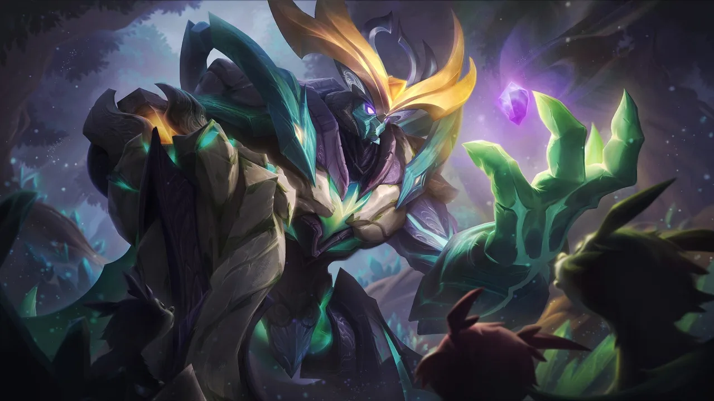

[Скины Белерика](https://boostmlbb.ru/skins/belerick.html)

[Скины](https://boostmlbb.ru/skins/)/[Белерик](https://boostmlbb.ru/skins/belerick.html)/Изумрудный страж

[Скин Белерика](https://boostmlbb.ru/skins/belerick.html)

# Изумрудный страж

Emerald Guardian

Исключительный ExceptionalОсобыйОграниченный

Как получить

Награда пропуска M3.

Вышел

22 ноября 2018

## Что меняет облик

-   Новая внешность
-   Новые эффекты навыков
-   Анимация показа
-   Бонус к характеристикам

## Все скины Белерика [6](https://boostmlbb.ru/skins/belerick.html)

[Тлеющая крепостьИсключительный · 2026](https://boostmlbb.ru/skins/belerick/smouldering-fortress.html)[Вершитель звёздДелюкс · 2025](https://boostmlbb.ru/skins/belerick/arbiter-of-stars.html)[Тигриный коготьОбычный · 2022](https://boostmlbb.ru/skins/belerick/tiger-s-claw.html)[Страж факелаОбычный · 2019](https://boostmlbb.ru/skins/belerick/torch-guardian.html)[Изумрудный стражИсключительный · 2018](https://boostmlbb.ru/skins/belerick/emerald-guardian.html)[Глубоко­водныйИсключительный · 2018](https://boostmlbb.ru/skins/belerick/the-deep-one.html)

## Серия «Особый»

[Тайный вердиктМатильда · 2026](https://boostmlbb.ru/skins/mathilda/arcane-verdict.html)[Вальс на ветруВэйл · 2026](https://boostmlbb.ru/skins/vale/windborne-waltz.html)[Капитан потерянныхФранко · 2026](https://boostmlbb.ru/skins/franco/captain-of-the-lost.html)[ВолнорезЛи Сун-Син · 2025](https://boostmlbb.ru/skins/yi-sun-shin/wavebreaker.html)[Стальные рукиБаданг · 2025](https://boostmlbb.ru/skins/badang/steel-arms.html)[Леди с зонтикомКагура · 2025](https://boostmlbb.ru/skins/kagura/lady-parasol.html)[Ужас пучиныАлдос · 2025](https://boostmlbb.ru/skins/aldous/fathom-terror.html)[Труппа лунного светаЧан'Э · 2025](https://boostmlbb.ru/skins/change/moonglow-troupe.html)

**Сколько стоит буст на герое Белерик?**Выберите текущий и желаемый ранг. Стоимость появится на сайте.

[Рассчитать цену](https://boostmlbb.ru/order.html?type=hero)

## Частые вопросы

Как получить скин «Изумрудный страж» на Белерика?

Награда пропуска M3.

Когда вышел скин «Изумрудный страж»?

22 ноября 2018.

Какой класс у скина «Изумрудный страж»?

Исключительный (Exceptional), серия «Особый».
