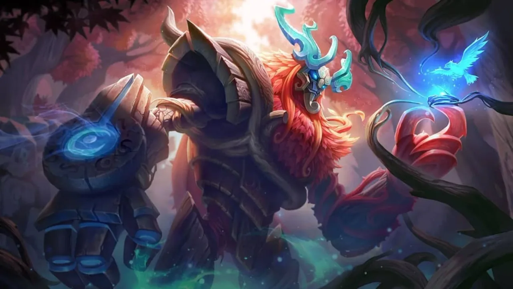

[Скины Белерика](https://boostmlbb.ru/skins/belerick.html)

[Скины](https://boostmlbb.ru/skins/)/[Белерик](https://boostmlbb.ru/skins/belerick.html)/Тигриный коготь

[Скин Белерика](https://boostmlbb.ru/skins/belerick.html)

# Тигриный коготь

Tiger's Claw

Обычный CommonВ продаже

Как получить

Продаётся в магазине обликов за 269 алмазов.

Цена

269 алмазов

Вышел

22 февраля 2022

## Что меняет облик

-   Бонус к характеристикам

## Все скины Белерика [6](https://boostmlbb.ru/skins/belerick.html)

[Тлеющая крепостьИсключительный · 2026](https://boostmlbb.ru/skins/belerick/smouldering-fortress.html)[Вершитель звёздДелюкс · 2025](https://boostmlbb.ru/skins/belerick/arbiter-of-stars.html)[Тигриный коготьОбычный · 2022](https://boostmlbb.ru/skins/belerick/tiger-s-claw.html)[Страж факелаОбычный · 2019](https://boostmlbb.ru/skins/belerick/torch-guardian.html)[Изумрудный стражИсключительный · 2018](https://boostmlbb.ru/skins/belerick/emerald-guardian.html)[Глубоко­водныйИсключительный · 2018](https://boostmlbb.ru/skins/belerick/the-deep-one.html)

**Сколько стоит буст на герое Белерик?**Выберите текущий и желаемый ранг. Стоимость появится на сайте.

[Рассчитать цену](https://boostmlbb.ru/order.html?type=hero)

## Частые вопросы

Как получить скин «Тигриный коготь» на Белерика?

Продаётся в магазине обликов за 269 алмазов.

Когда вышел скин «Тигриный коготь»?

22 февраля 2022.

Какой класс у скина «Тигриный коготь»?

Обычный (Common).
