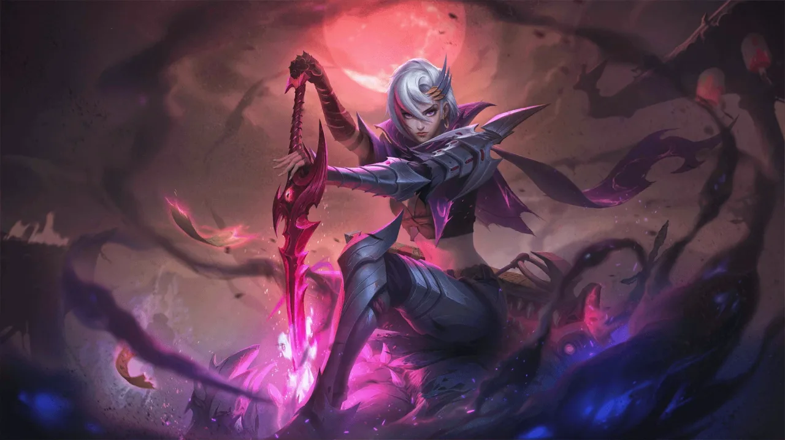

[Скины Бенедетты](https://boostmlbb.ru/skins/benedetta.html)

[Скины](https://boostmlbb.ru/skins/)/[Бенедетта](https://boostmlbb.ru/skins/benedetta.html)/Клятва смерти

[Скин Бенедетты](https://boostmlbb.ru/skins/benedetta.html)

# Клятва смерти

Death Oath

Изысканный ExquisiteКоллекционныйОграниченный

Как получить

Главный приз розыгрыша в коллекционном событии, попытки покупаются за алмазы. Ограниченные облики иногда возвращаются в розыгрышах событий.

Вышел

5 июля 2021

## Что меняет облик

-   Новая внешность
-   Новые эффекты навыков
-   Звуки навыков
-   Своя озвучка
-   Анимация показа
-   Сцена показа
-   Музыка показа
-   Особые действия
-   Бонус к характеристикам

## Все скины Бенедетты [7](https://boostmlbb.ru/skins/benedetta.html)

[Призрачный миражДелюкс · 2025](https://boostmlbb.ru/skins/benedetta/phantom-mirage.html)[Квантовое лезвиеИсключительный · 2024](https://boostmlbb.ru/skins/benedetta/quantum-edge.html)[Гонщица на Panigale V4SГрандиозный · 2023](https://boostmlbb.ru/skins/benedetta/panigale-v4s-rider.html)[Лунный клинокИсключительный · 2022](https://boostmlbb.ru/skins/benedetta/moonblade.html)[Клятва смертиИзысканный · 2021](https://boostmlbb.ru/skins/benedetta/death-oath.html)[Уличная задираИсключительный · 2021](https://boostmlbb.ru/skins/benedetta/street-thrasher.html)[Клинок честиОбычный · 2020](https://boostmlbb.ru/skins/benedetta/honor-blade.html)

## Серия «Коллекционный»

[ОчистительБруно · 2026](https://boostmlbb.ru/skins/bruno/the-purifier.html)[Небесный бунтарьСан · 2026](https://boostmlbb.ru/skins/sun/celestial-rebel.html)[Кайдзю глубинХелкарт · 2026](https://boostmlbb.ru/skins/helcurt/kaiju-of-the-deep.html)[Звёздный дозорныйКимми · 2026](https://boostmlbb.ru/skins/kimmy/starbound-sentry.html)[Монархиня грёзАлиса · 2026](https://boostmlbb.ru/skins/alice/dreaming-monarch.html)[Дрожь глубинГрок · 2026](https://boostmlbb.ru/skins/grock/tremor-of-the-deep.html)[Небесный генералТигрил · 2026](https://boostmlbb.ru/skins/tigreal/celestial-general.html)[Монарх, рождённый солнцемКсавьер · 2026](https://boostmlbb.ru/skins/xavier/sunborn-monarch.html)

**Сколько стоит буст на герое Бенедетта?**Выберите текущий и желаемый ранг. Стоимость появится на сайте.

[Рассчитать цену](https://boostmlbb.ru/order.html?type=hero)

## Частые вопросы

Как получить скин «Клятва смерти» на Бенедетту?

Главный приз розыгрыша в коллекционном событии, попытки покупаются за алмазы. Ограниченные облики иногда возвращаются в розыгрышах событий.

Когда вышел скин «Клятва смерти»?

5 июля 2021.

Какой класс у скина «Клятва смерти»?

Изысканный (Exquisite), серия «Коллекционный».
