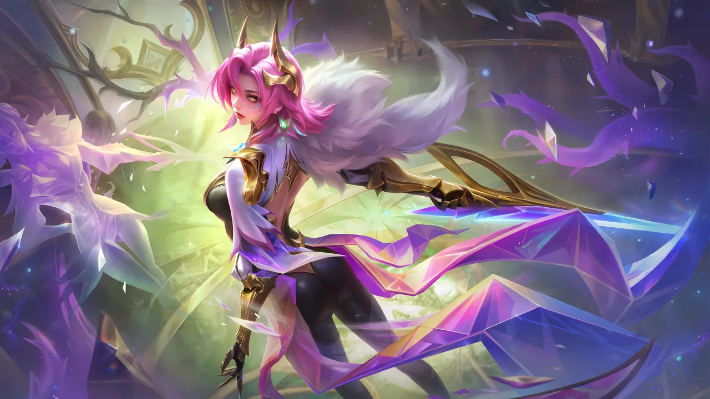

[Скины Бенедетты](https://boostmlbb.ru/skins/benedetta.html)

[Скины](https://boostmlbb.ru/skins/)/[Бенедетта](https://boostmlbb.ru/skins/benedetta.html)/Призрачный мираж

[Скин Бенедетты](https://boostmlbb.ru/skins/benedetta.html)

# Призрачный мираж

Phantom Mirage

Делюкс DeluxeЗаветОграниченный

Как получить

Выходил в событии «Завет». Ограниченные облики иногда возвращаются в розыгрышах событий.

Вышел

19 марта 2025

## Что меняет облик

-   Новая внешность
-   Новые эффекты навыков
-   Звуки навыков
-   Своя озвучка
-   Анимация показа
-   Сцена показа
-   Музыка показа
-   Бонус к характеристикам

## Все скины Бенедетты [7](https://boostmlbb.ru/skins/benedetta.html)

[Призрачный миражДелюкс · 2025](https://boostmlbb.ru/skins/benedetta/phantom-mirage.html)[Квантовое лезвиеИсключительный · 2024](https://boostmlbb.ru/skins/benedetta/quantum-edge.html)[Гонщица на Panigale V4SГрандиозный · 2023](https://boostmlbb.ru/skins/benedetta/panigale-v4s-rider.html)[Лунный клинокИсключительный · 2022](https://boostmlbb.ru/skins/benedetta/moonblade.html)[Клятва смертиИзысканный · 2021](https://boostmlbb.ru/skins/benedetta/death-oath.html)[Уличная задираИсключительный · 2021](https://boostmlbb.ru/skins/benedetta/street-thrasher.html)[Клинок честиОбычный · 2020](https://boostmlbb.ru/skins/benedetta/honor-blade.html)

## Серия «Завет»

[Призрачное весельеЛилия · 2026](https://boostmlbb.ru/skins/lylia/phantasmal-revelry.html)[Кровавый распоря­дительНатан · 2026](https://boostmlbb.ru/skins/natan/sanguine-steward.html)[Чары полуночиЭйдора · 2026](https://boostmlbb.ru/skins/eudora/midnight-s-allure.html)[Герцогиня приливовЛесли · 2025](https://boostmlbb.ru/skins/lesley/duchess-of-tides.html)

**Сколько стоит буст на герое Бенедетта?**Выберите текущий и желаемый ранг. Стоимость появится на сайте.

[Рассчитать цену](https://boostmlbb.ru/order.html?type=hero)

## Частые вопросы

Как получить скин «Призрачный мираж» на Бенедетту?

Выходил в событии «Завет». Ограниченные облики иногда возвращаются в розыгрышах событий.

Когда вышел скин «Призрачный мираж»?

19 марта 2025.

Какой класс у скина «Призрачный мираж»?

Делюкс (Deluxe), серия «Завет».
