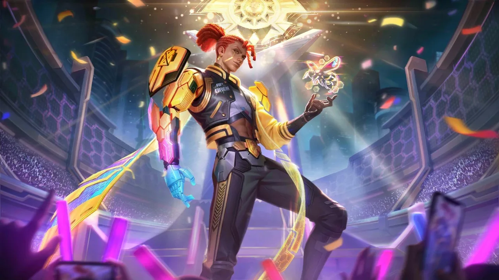

[Тир-лист](https://boostmlbb.ru/heroes/)[Предметы](https://boostmlbb.ru/items/)[Скины](https://boostmlbb.ru/skins/)[Новости и гайды](https://boostmlbb.ru/news/)

[Скины](https://boostmlbb.ru/skins/)/[Броуди](https://boostmlbb.ru/skins/brody.html)/APBren

[Скин Броуди](https://boostmlbb.ru/skins/brody.html)

# APBren

Делюкс DeluxeЧемпионскийОграниченный

Как получить

Киберспортивный облик (Чемпионский): выходил в событии турнира. Ограниченные облики иногда возвращаются в розыгрышах событий.

Вышел

19 сентября 2024

## Что меняет облик

-   Новая внешность
-   Новые эффекты навыков
-   Звуки навыков
-   Своя озвучка
-   Анимация показа
-   Сцена показа
-   Музыка показа
-   Бонус к характеристикам

## Все скины Броуди [7](https://boostmlbb.ru/skins/brody.html)

[Броуди NeobeastГрандиозный · 2025](https://boostmlbb.ru/skins/brody/neobeast-brody.html)[APBrenДелюкс · 2024](https://boostmlbb.ru/skins/brody/apbren.html)[Квантовая хваткаИсключительный · 2023](https://boostmlbb.ru/skins/brody/quantum-grip.html)[РудохимикИзысканный · 2022](https://boostmlbb.ru/skins/brody/ore-chemist.html)[Смер­тельный клыкИсключительный · 2021](https://boostmlbb.ru/skins/brody/lethal-fang.html)[Броуди S.T.U.N.Делюкс · 2021](https://boostmlbb.ru/skins/brody/s-t-u-n-brody.html)[Безымянный бродягаОбычный · 2020](https://boostmlbb.ru/skins/brody/nameless-stray.html)

## Серия «Чемпионский»

[EVOS LegendsХарит · 2025](https://boostmlbb.ru/skins/harith/evos-legends.html)[Blacklist Interna­tionalЭстес · 2024](https://boostmlbb.ru/skins/estes/blacklist-international.html)[ECHOЧу · 2023](https://boostmlbb.ru/skins/chou/echo.html)[Bren EsportsЛанселот · 2020](https://boostmlbb.ru/skins/lancelot/bren-esports.html)

**Поднимем ранг на герое Броуди**Цена считается в калькуляторе

[Рассчитать цену](https://boostmlbb.ru/order.html?type=hero)

## Частые вопросы

Как получить скин «APBren» на Броуди?

Киберспортивный облик (Чемпионский): выходил в событии турнира. Ограниченные облики иногда возвращаются в розыгрышах событий.

Когда вышел скин «APBren»?

19 сентября 2024.

Какой класс у скина «APBren»?

Делюкс (Deluxe), серия «Чемпионский».
