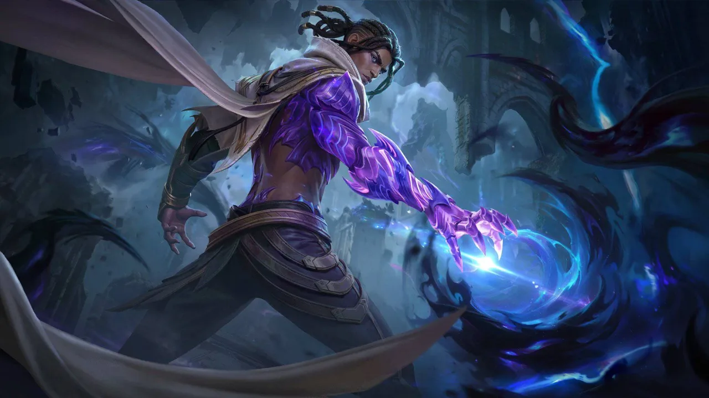

[Тир-лист](https://boostmlbb.ru/heroes/)[Предметы](https://boostmlbb.ru/items/)[Скины](https://boostmlbb.ru/skins/)[Новости и гайды](https://boostmlbb.ru/news/)

[Скины](https://boostmlbb.ru/skins/)/[Броуди](https://boostmlbb.ru/skins/brody.html)/Безымянный бродяга

[Скин Броуди](https://boostmlbb.ru/skins/brody.html)

# Безымянный бродяга

Nameless Stray

Обычный CommonВ продаже

Как получить

Продаётся в магазине обликов за 269 алмазов.

Цена

269 алмазов

Вышел

16 октября 2020

## Что меняет облик

-   Бонус к характеристикам

## Все скины Броуди [7](https://boostmlbb.ru/skins/brody.html)

[Броуди NeobeastГрандиозный · 2025](https://boostmlbb.ru/skins/brody/neobeast-brody.html)[APBrenДелюкс · 2024](https://boostmlbb.ru/skins/brody/apbren.html)[Квантовая хваткаИсключительный · 2023](https://boostmlbb.ru/skins/brody/quantum-grip.html)[РудохимикИзысканный · 2022](https://boostmlbb.ru/skins/brody/ore-chemist.html)[Смер­тельный клыкИсключительный · 2021](https://boostmlbb.ru/skins/brody/lethal-fang.html)[Броуди S.T.U.N.Делюкс · 2021](https://boostmlbb.ru/skins/brody/s-t-u-n-brody.html)[Безымянный бродягаОбычный · 2020](https://boostmlbb.ru/skins/brody/nameless-stray.html)

**Поднимем ранг на герое Броуди**Цена считается в калькуляторе

[Рассчитать цену](https://boostmlbb.ru/order.html?type=hero)

## Частые вопросы

Как получить скин «Безымянный бродяга» на Броуди?

Продаётся в магазине обликов за 269 алмазов.

Когда вышел скин «Безымянный бродяга»?

16 октября 2020.

Какой класс у скина «Безымянный бродяга»?

Обычный (Common).
