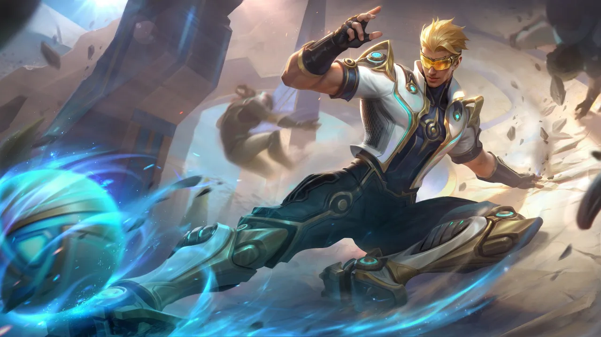

[Все скины](https://boostmlbb.ru/skins/)

[Скины](https://boostmlbb.ru/skins/)/Бруно

# Скины Бруно

Скинов

9

Можно купить

4

Последний

[Очиститель](https://boostmlbb.ru/skins/bruno/the-purifier.html)2026

[Профиль героя→](https://boostmlbb.ru/heroes/bruno.html)

## Все скины

ВсеГрандиозныйИзысканныйДелюксИсключительныйОбычный

[ОчистительИзысканный · 2026](https://boostmlbb.ru/skins/bruno/the-purifier.html)[Уличный хайпИсключительный · 2024](https://boostmlbb.ru/skins/bruno/street-hype.html)[Неймар-младшийИсключительный · 2022](https://boostmlbb.ru/skins/bruno/neymar-jr.html)[Нападающий HaloДелюкс · 2022](https://boostmlbb.ru/skins/bruno/halo-striker.html)[Огненный разрядГрандиозный · 2020](https://boostmlbb.ru/skins/bruno/firebolt.html)[СоколИсключительный · 2020](https://boostmlbb.ru/skins/bruno/the-falcon.html)[Уличный футболОбычный · 2018](https://boostmlbb.ru/skins/bruno/street-football.html)[Лучший диджейИсключительный · 2016](https://boostmlbb.ru/skins/bruno/best-dj.html)[Элита авангардаОбычный · 2016](https://boostmlbb.ru/skins/bruno/vanguard-elite.html)

**Сколько стоит буст на герое Бруно?**Выберите текущий и желаемый ранг. Стоимость появится на сайте.

[Рассчитать цену](https://boostmlbb.ru/order.html?type=hero)

## Частые вопросы

Сколько скинов у Бруно?

9 скинов без стандартного облика. Последний — «Очиститель» (The Purifier), ноябрь 2026.

Какие скины Бруно можно купить сейчас?

«Сокол» (749 алмазов), «Уличный футбол» (599 алмазов), «Лучший диджей» (749 алмазов), «Элита авангарда» (399 алмазов). Остальные облики ограниченные и возвращаются только в событиях.

Какой самый редкий скин Бруно?

«Огненный разряд» (Firebolt), класс грандиозный, серия «Восходящие звёзды». Выходил в событии «Восходящие звёзды». Ограниченные облики иногда возвращаются в розыгрышах событий.
