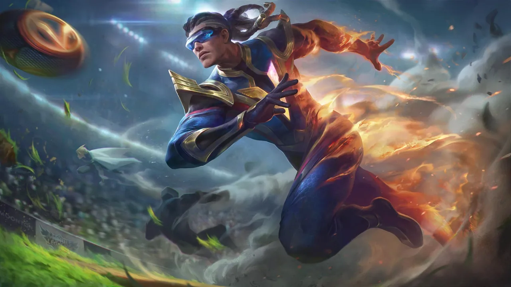
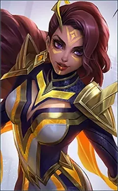

[Тир-лист](https://boostmlbb.ru/heroes/)[Предметы](https://boostmlbb.ru/items/)[Скины](https://boostmlbb.ru/skins/)[Новости и гайды](https://boostmlbb.ru/news/)

[Скины](https://boostmlbb.ru/skins/)/[Бруно](https://boostmlbb.ru/skins/bruno.html)/Огненный разряд

[Скин Бруно](https://boostmlbb.ru/skins/bruno.html)

# Огненный разряд

Firebolt

Грандиозный GrandВосходящие звёздыОграниченный

Как получить

Выходил в событии «Восходящие звёзды». Ограниченные облики иногда возвращаются в розыгрышах событий.

Вышел

2020 год

## Что меняет облик

-   Новая внешность
-   Новые эффекты навыков
-   Звуки навыков
-   Своя озвучка
-   Анимация показа
-   Сцена показа
-   Бонус к характеристикам

## Все скины Бруно [9](https://boostmlbb.ru/skins/bruno.html)

[ОчистительИзысканный · 2026](https://boostmlbb.ru/skins/bruno/the-purifier.html)[Уличный хайпИсключительный · 2024](https://boostmlbb.ru/skins/bruno/street-hype.html)[Неймар-младшийИсключительный · 2022](https://boostmlbb.ru/skins/bruno/neymar-jr.html)[Нападающий HaloДелюкс · 2022](https://boostmlbb.ru/skins/bruno/halo-striker.html)[Огненный разрядГрандиозный · 2020](https://boostmlbb.ru/skins/bruno/firebolt.html)[СоколИсключительный · 2020](https://boostmlbb.ru/skins/bruno/the-falcon.html)[Уличный футболОбычный · 2018](https://boostmlbb.ru/skins/bruno/street-football.html)[Лучший диджейИсключительный · 2016](https://boostmlbb.ru/skins/bruno/best-dj.html)[Элита авангардаОбычный · 2016](https://boostmlbb.ru/skins/bruno/vanguard-elite.html)

## Серия «Восходящие звёзды»

[Мастер мечаЛанселот · 2024](https://boostmlbb.ru/skins/lancelot/swordmaster.html)[Снежная буряВэйл · 2023](https://boostmlbb.ru/skins/vale/blizzard-storm.html)[Прорица­тельницаЭсмеральда · 2023](https://boostmlbb.ru/skins/esmeralda/the-foreseer.html)[Громовой кулакЧу · 2021](https://boostmlbb.ru/skins/chou/thunderfist.html)

**Поднимем ранг на герое Бруно**Цена считается в калькуляторе

[Рассчитать цену](https://boostmlbb.ru/order.html?type=hero)

## Частые вопросы

Как получить скин «Огненный разряд» на Бруно?

Выходил в событии «Восходящие звёзды». Ограниченные облики иногда возвращаются в розыгрышах событий.

Когда вышел скин «Огненный разряд»?

2020 год.

Какой класс у скина «Огненный разряд»?

Грандиозный (Grand), серия «Восходящие звёзды».
