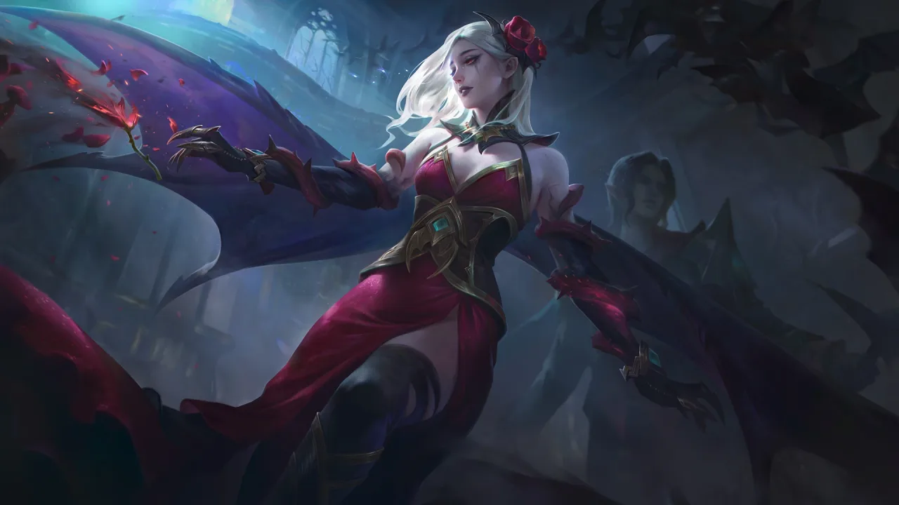

[Все скины](https://boostmlbb.ru/skins/)

[Скины](https://boostmlbb.ru/skins/)/Кармилла

# Скины Кармиллы

Скинов

4

Можно купить

4

Последний

[Астральный аркан](https://boostmlbb.ru/skins/carmilla/astral-arcana.html)2024

[Профиль героя→](https://boostmlbb.ru/heroes/carmilla.html)

## Все скины

[Астральный арканДелюкс · 2024](https://boostmlbb.ru/skins/carmilla/astral-arcana.html)[Призрачная графиняИсключительный · 2021](https://boostmlbb.ru/skins/carmilla/phantom-countess.html)[Девочка-волшебницаОбычный · 2020](https://boostmlbb.ru/skins/carmilla/magician-girl.html)[Графиня глицинииОбычный · 2020](https://boostmlbb.ru/skins/carmilla/wisteria-countess.html)

**Сколько стоит буст на герое Кармилла?**Выберите текущий и желаемый ранг. Стоимость появится на сайте.

[Рассчитать цену](https://boostmlbb.ru/order.html?type=hero)

## Частые вопросы

Сколько скинов у Кармиллы?

4 скина без стандартного облика. Последний — «Астральный аркан» (Astral Arcana), 26 июля 2024.

Какие скины Кармиллы можно купить сейчас?

«Астральный аркан» (899 алмазов), «Призрачная графиня» (749 алмазов), «Девочка-волшебница» (599 алмазов), «Графиня глицинии» (269 алмазов). Остальные облики ограниченные и возвращаются только в событиях.

Какой самый редкий скин Кармиллы?

«Астральный аркан» (Astral Arcana), класс делюкс, серия «Эпический». Продаётся в магазине обликов за 899 алмазов.
