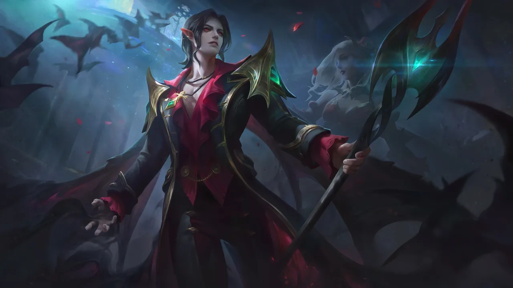
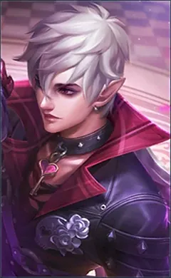

[Все скины](https://boostmlbb.ru/skins/)

[Скины](https://boostmlbb.ru/skins/)/Сесилион

# Скины Сесилиона

Скинов

6

Можно купить

3

Последний

[Хисока](https://boostmlbb.ru/skins/cecilion/hisoka.html)2025

[Профиль героя→](https://boostmlbb.ru/heroes/cecilion.html)

## Все скины

[ХисокаГрандиозный · 2025](https://boostmlbb.ru/skins/cecilion/hisoka.html)[Багровые крыльяИзысканный · 2022](https://boostmlbb.ru/skins/cecilion/crimson-wings.html)[ЗвездочётИсключительный · 2022](https://boostmlbb.ru/skins/cecilion/stargazer.html)[Призрачный графИсключительный · 2021](https://boostmlbb.ru/skins/cecilion/phantom-count.html)[Иллю­зионистОбычный · 2020](https://boostmlbb.ru/skins/cecilion/the-illusionist.html)[Граф глицинииОбычный · 2020](https://boostmlbb.ru/skins/cecilion/wisteria-count.html)

**Сколько стоит буст на герое Сесилион?**Выберите текущий и желаемый ранг. Стоимость появится на сайте.

[Рассчитать цену](https://boostmlbb.ru/order.html?type=hero)

## Частые вопросы

Сколько скинов у Сесилиона?

6 скинов без стандартного облика. Последний — «Хисока» (Hisoka), 14 января 2025.

Какие скины Сесилиона можно купить сейчас?

«Призрачный граф» (749 алмазов), «Иллюзионист» (599 алмазов), «Граф глицинии» (269 алмазов). Остальные облики ограниченные и возвращаются только в событиях.

Какой самый редкий скин Сесилиона?

«Хисока» (Hisoka), класс грандиозный, серия «Охотник × Охотник». Выходил в событии коллаборации MLBB × Охотник × Охотник. Ограниченные облики иногда возвращаются в розыгрышах событий.
