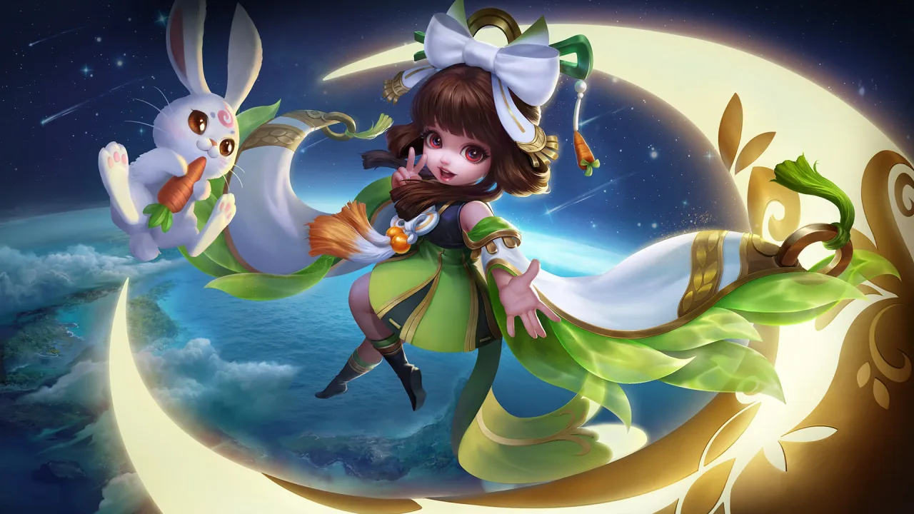

[Все скины](https://boostmlbb.ru/skins/)

[Скины](https://boostmlbb.ru/skins/)/Чан'Э

# Скины Чан'Э

Скинов

11

Можно купить

4

Последний

[Золотой османтус](https://boostmlbb.ru/skins/change/golden-osmanthus.html)2026

[Профиль героя→](https://boostmlbb.ru/heroes/change.html)

## Все скины

ВсеГрандиозныйИзысканныйДелюксИсключительныйОбычный

[Золотой османтусОбычный · 2026](https://boostmlbb.ru/skins/change/golden-osmanthus.html)[Труппа лунного светаИсключительный · 2025](https://boostmlbb.ru/skins/change/moonglow-troupe.html)[Техни­ческий генийГрандиозный · 2024](https://boostmlbb.ru/skins/change/tech-tensai.html)[НоволуниеДелюкс · 2023](https://boostmlbb.ru/skins/change/new-moon.html)[Лунная художницаГрандиозный · 2022](https://boostmlbb.ru/skins/change/moon-artist.html)[Колыбель из лозДелюкс · 2021](https://boostmlbb.ru/skins/change/vine-cradle.html)[Клубничное парфеИсключительный · 2020](https://boostmlbb.ru/skins/change/strawberry-parfait.html)[Лунная магияИзысканный · 2020](https://boostmlbb.ru/skins/change/lunar-magic.html)[Цветочная эльфийкаИсключительный · 2019](https://boostmlbb.ru/skins/change/floral-elfo.html)[Багровая лунаОбычный · 2019](https://boostmlbb.ru/skins/change/crimson-moon.html)[ЛунатичкаОбычный · 2018](https://boostmlbb.ru/skins/change/moonstruck.html)

**Сколько стоит буст на герое Чан'Э?**Выберите текущий и желаемый ранг. Стоимость появится на сайте.

[Рассчитать цену](https://boostmlbb.ru/order.html?type=hero)

## Частые вопросы

Сколько скинов у Чан'Э?

11 скинов без стандартного облика. Последний — «Золотой османтус» (Golden Osmanthus), 25 сентября 2026.

Какие скины Чан'Э можно купить сейчас?

«Колыбель из лоз» (899 алмазов), «Цветочная эльфийка» (749 алмазов), «Багровая луна» (599 алмазов), «Лунатичка» (269 алмазов). Остальные облики ограниченные и возвращаются только в событиях.

Какой самый редкий скин Чан'Э?

«Технический гений» (Tech Tensai), класс грандиозный, серия «Претенденты». Выходил в событии «Претенденты». Ограниченные облики иногда возвращаются в розыгрышах событий.
