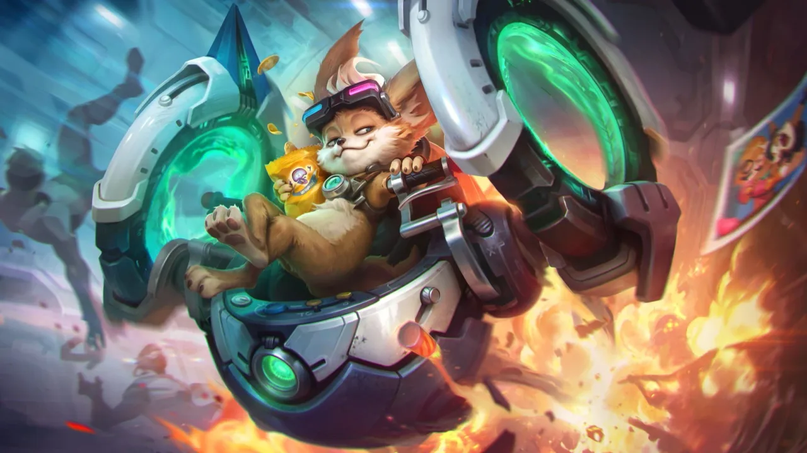

[Все скины](https://boostmlbb.ru/skins/)

[Скины](https://boostmlbb.ru/skins/)/Чип

# Скины Чипа

Скинов

2

Можно купить

1

Последний

[Инженер нексуса](https://boostmlbb.ru/skins/chip/nexus-engineer.html)2024

[Профиль героя→](https://boostmlbb.ru/heroes/chip.html)

## Все скины

[Инженер нексусаОбычный · 2024](https://boostmlbb.ru/skins/chip/nexus-engineer.html)[Привал в пустошахОбычный · 2024](https://boostmlbb.ru/skins/chip/badlands-hiatus.html)

**Сколько стоит буст на герое Чип?**Выберите текущий и желаемый ранг. Стоимость появится на сайте.

[Рассчитать цену](https://boostmlbb.ru/order.html?type=hero)

## Частые вопросы

Сколько скинов у Чипа?

2 скина без стандартного облика. Последний — «Инженер нексуса» (Nexus Engineer), 16 марта 2024.

Какие скины Чипа можно купить сейчас?

«Инженер нексуса» (269 алмазов). Остальные облики ограниченные и возвращаются только в событиях.

Какой самый редкий скин Чипа?

«Инженер нексуса» (Nexus Engineer), класс обычный. Продаётся в магазине обликов за 269 алмазов.
