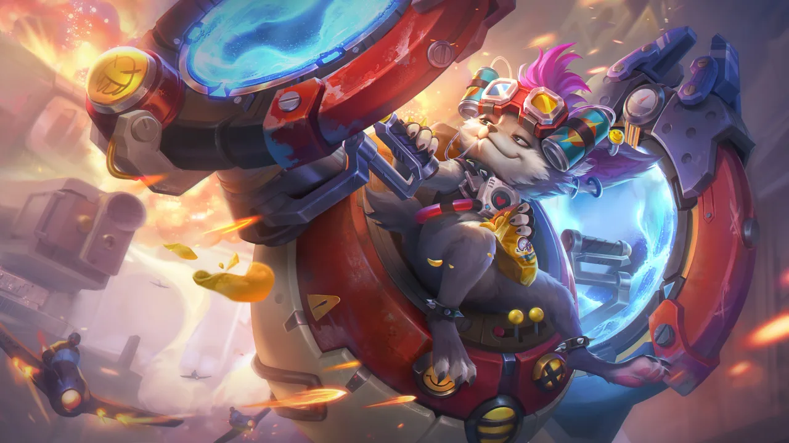

[Тир-лист](https://boostmlbb.ru/heroes/)[Предметы](https://boostmlbb.ru/items/)[Скины](https://boostmlbb.ru/skins/)[Новости и гайды](https://boostmlbb.ru/news/)

[Скины](https://boostmlbb.ru/skins/)/[Чип](https://boostmlbb.ru/skins/chip.html)/Привал в пустошах

[Скин Чипа](https://boostmlbb.ru/skins/chip.html)

# Привал в пустошах

Badlands Hiatus

Обычный CommonЭлитныйОграниченный

Как получить

Цена на старте: 599 алмазов. Сейчас в магазине не продаётся, возвращается только в событиях.

Цена

599 алмазов

Вышел

2024 год

## Что меняет облик

-   Новая внешность
-   Другой цвет эффектов
-   Анимация показа
-   Бонус к характеристикам

## Все скины Чипа [2](https://boostmlbb.ru/skins/chip.html)

[Инженер нексусаОбычный · 2024](https://boostmlbb.ru/skins/chip/nexus-engineer.html)[Привал в пустошахОбычный · 2024](https://boostmlbb.ru/skins/chip/badlands-hiatus.html)

## Серия «Элитный»

[Золотой османтусЧан'Э · 2026](https://boostmlbb.ru/skins/change/golden-osmanthus.html)[Король-воена­чальникМартис · 2025](https://boostmlbb.ru/skins/martis/warlord-king.html)[Кадет открытого моряКимми · 2024](https://boostmlbb.ru/skins/kimmy/high-seas-cadet.html)[Зелёная копейщицаСильвана · 2024](https://boostmlbb.ru/skins/silvanna/verdant-lancer.html)[Мародёр Кровавое КопытоХилос · 2024](https://boostmlbb.ru/skins/hylos/bloodhoof-marauder.html)[Изящная бабочкаГвиневра · 2024](https://boostmlbb.ru/skins/guinevere/elegant-butterfly.html)[Маркиз клинковЛанселот · 2024](https://boostmlbb.ru/skins/lancelot/marques-of-blades.html)[Звёздный фокусникХарли · 2024](https://boostmlbb.ru/skins/harley/star-magician.html)

**Поднимем ранг на герое Чип**Цена считается в калькуляторе

[Рассчитать цену](https://boostmlbb.ru/order.html?type=hero)

## Частые вопросы

Как получить скин «Привал в пустошах» на Чипа?

Цена на старте: 599 алмазов. Сейчас в магазине не продаётся, возвращается только в событиях.

Когда вышел скин «Привал в пустошах»?

2024 год.

Какой класс у скина «Привал в пустошах»?

Обычный (Common), серия «Элитный».
