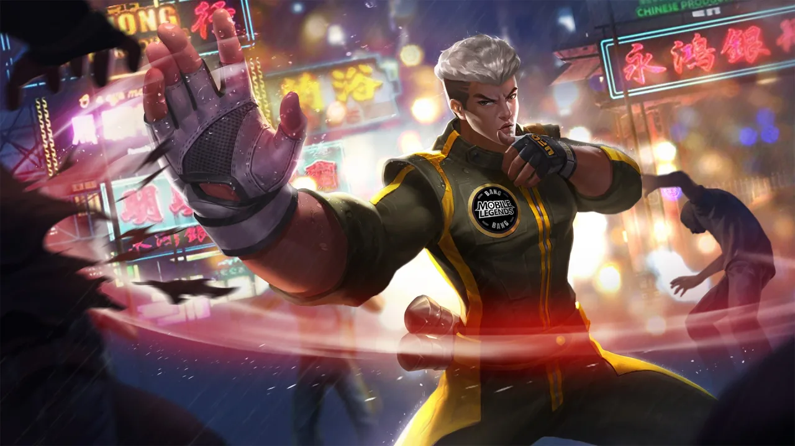
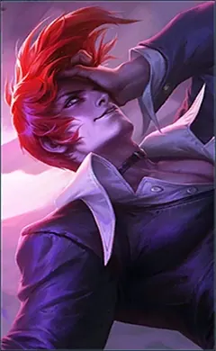

[Все скины](https://boostmlbb.ru/skins/)

[Скины](https://boostmlbb.ru/skins/)/Чу

# Скины Чу

Скинов

11

Можно купить

3

Последний

[ECHO](https://boostmlbb.ru/skins/chou/echo.html)2023

[Профиль героя→](https://boostmlbb.ru/heroes/chou.html)

## Все скины

ВсеГрандиозныйИзысканныйДелюксИсключительныйОбычный

[ECHOДелюкс · 2023](https://boostmlbb.ru/skins/chou/echo.html)[Дракон СирюДелюкс · 2022](https://boostmlbb.ru/skins/chou/dragon-shiryu.html)[Весы СирюГрандиозный · 2022](https://boostmlbb.ru/skins/chou/libra-shiryu.html)[Чу S.T.U.N.Делюкс · 2021](https://boostmlbb.ru/skins/chou/s-t-u-n-chou.html)[Громовой кулакГрандиозный · 2021](https://boostmlbb.ru/skins/chou/thunderfist.html)[Вне себяИсключительный · 2019](https://boostmlbb.ru/skins/chou/go-ballistic.html)[Иори ЯгамиГрандиозный · 2019](https://boostmlbb.ru/skins/chou/iori-yagami.html)[Яростный тигрИсключительный · 2018](https://boostmlbb.ru/skins/chou/furious-tiger.html)[Король муай-тайОбычный · 2017](https://boostmlbb.ru/skins/chou/king-of-muay-thai.html)[Мальчик-драконИзысканный · 2017](https://boostmlbb.ru/skins/chou/dragon-boy.html)[Хип-хоп пареньОбычный · 2016](https://boostmlbb.ru/skins/chou/hip-hop-boy.html)

**Сколько стоит буст на герое Чу?**Выберите текущий и желаемый ранг. Стоимость появится на сайте.

[Рассчитать цену](https://boostmlbb.ru/order.html?type=hero)

## Частые вопросы

Сколько скинов у Чу?

11 скинов без стандартного облика. Последний — «ECHO» (ECHO), 14 августа 2023.

Какие скины Чу можно купить сейчас?

«Яростный тигр» (749 алмазов), «Король муай-тай» (599 алмазов), «Хип-хоп парень» (269 алмазов). Остальные облики ограниченные и возвращаются только в событиях.

Какой самый редкий скин Чу?

«Весы Сирю» (Libra Shiryu), класс грандиозный, серия «Рыцари Зодиака». Выходил в событии коллаборации MLBB × Saint Seiya.
