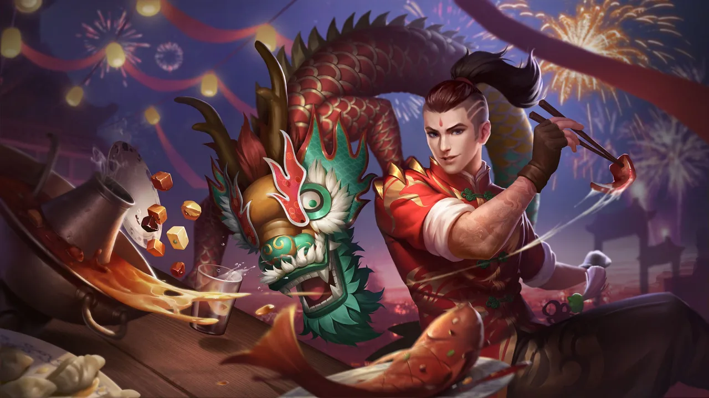

[Тир-лист](https://boostmlbb.ru/heroes/)[Предметы](https://boostmlbb.ru/items/)[Скины](https://boostmlbb.ru/skins/)[Новости и гайды](https://boostmlbb.ru/news/)

[Скины](https://boostmlbb.ru/skins/)/[Чу](https://boostmlbb.ru/skins/chou.html)/Мальчик-дракон

[Скин Чу](https://boostmlbb.ru/skins/chou.html)

# Мальчик-дракон

Dragon Boy

Изысканный ExquisiteЯщик удачиОграниченный

Как получить

Выпадал из ящиков удачи в событиях. Ограниченные облики иногда возвращаются в розыгрышах событий.

Вышел

2017 год

## Что меняет облик

-   Новая внешность
-   Новые эффекты навыков
-   Анимация показа
-   Сцена показа
-   Бонус к характеристикам

## Все скины Чу [11](https://boostmlbb.ru/skins/chou.html)

[ECHOДелюкс · 2023](https://boostmlbb.ru/skins/chou/echo.html)[Дракон СирюДелюкс · 2022](https://boostmlbb.ru/skins/chou/dragon-shiryu.html)[Весы СирюГрандиозный · 2022](https://boostmlbb.ru/skins/chou/libra-shiryu.html)[Чу S.T.U.N.Делюкс · 2021](https://boostmlbb.ru/skins/chou/s-t-u-n-chou.html)[Громовой кулакГрандиозный · 2021](https://boostmlbb.ru/skins/chou/thunderfist.html)[Вне себяИсключительный · 2019](https://boostmlbb.ru/skins/chou/go-ballistic.html)[Иори ЯгамиГрандиозный · 2019](https://boostmlbb.ru/skins/chou/iori-yagami.html)[Яростный тигрИсключительный · 2018](https://boostmlbb.ru/skins/chou/furious-tiger.html)[Король муай-тайОбычный · 2017](https://boostmlbb.ru/skins/chou/king-of-muay-thai.html)[Мальчик-драконИзысканный · 2017](https://boostmlbb.ru/skins/chou/dragon-boy.html)[Хип-хоп пареньОбычный · 2016](https://boostmlbb.ru/skins/chou/hip-hop-boy.html)

## Серия «Ящик удачи»

[Леди-журавльГвиневра · 2025](https://boostmlbb.ru/skins/guinevere/lady-crane.html)[Серафим-бабочкаЛюнокс · 2025](https://boostmlbb.ru/skins/lunox/butterfly-seraphim.html)[МехадраконКлауд · 2025](https://boostmlbb.ru/skins/claude/mecha-dragon.html)[Лунная магияЧан'Э · 2020](https://boostmlbb.ru/skins/change/lunar-magic.html)[Громовая вспышкаСелена · 2020](https://boostmlbb.ru/skins/selena/thunder-flash.html)[РакшасаХанаби · 2020](https://boostmlbb.ru/skins/hanabi/rakshesha.html)[Повелитель видеоигрУранус · 2020](https://boostmlbb.ru/skins/uranus/video-game-dominator.html)[Бог войныМартис · 2020](https://boostmlbb.ru/skins/martis/god-of-war.html)

**Поднимем ранг на герое Чу**Цена считается в калькуляторе

[Рассчитать цену](https://boostmlbb.ru/order.html?type=hero)

## Частые вопросы

Как получить скин «Мальчик-дракон» на Чу?

Выпадал из ящиков удачи в событиях. Ограниченные облики иногда возвращаются в розыгрышах событий.

Когда вышел скин «Мальчик-дракон»?

2017 год.

Какой класс у скина «Мальчик-дракон»?

Изысканный (Exquisite), серия «Ящик удачи».
