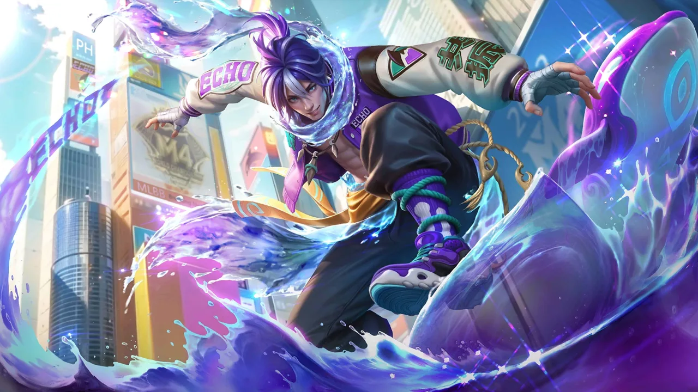
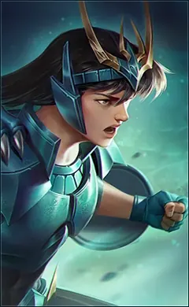
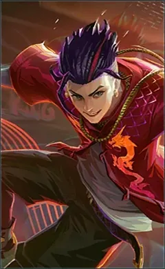

[Тир-лист](https://boostmlbb.ru/heroes/)[Предметы](https://boostmlbb.ru/items/)[Скины](https://boostmlbb.ru/skins/)[Новости и гайды](https://boostmlbb.ru/news/)

[Скины](https://boostmlbb.ru/skins/)/[Чу](https://boostmlbb.ru/skins/chou.html)/ECHO

[Скин Чу](https://boostmlbb.ru/skins/chou.html)

# ECHO

Делюкс DeluxeЧемпионскийОграниченный

Как получить

Цена на старте: 899 алмазов. Сейчас в магазине не продаётся, возвращается только в событиях.

Цена

899 алмазов

Вышел

14 августа 2023

## Что меняет облик

-   Новая внешность
-   Новые эффекты навыков
-   Звуки навыков
-   Анимация показа
-   Сцена показа
-   Музыка показа
-   Бонус к характеристикам

## Все скины Чу [11](https://boostmlbb.ru/skins/chou.html)

[ECHOДелюкс · 2023](https://boostmlbb.ru/skins/chou/echo.html)[Дракон СирюДелюкс · 2022](https://boostmlbb.ru/skins/chou/dragon-shiryu.html)[Весы СирюГрандиозный · 2022](https://boostmlbb.ru/skins/chou/libra-shiryu.html)[Чу S.T.U.N.Делюкс · 2021](https://boostmlbb.ru/skins/chou/s-t-u-n-chou.html)[Громовой кулакГрандиозный · 2021](https://boostmlbb.ru/skins/chou/thunderfist.html)[Вне себяИсключительный · 2019](https://boostmlbb.ru/skins/chou/go-ballistic.html)[Иори ЯгамиГрандиозный · 2019](https://boostmlbb.ru/skins/chou/iori-yagami.html)[Яростный тигрИсключительный · 2018](https://boostmlbb.ru/skins/chou/furious-tiger.html)[Король муай-тайОбычный · 2017](https://boostmlbb.ru/skins/chou/king-of-muay-thai.html)[Мальчик-драконИзысканный · 2017](https://boostmlbb.ru/skins/chou/dragon-boy.html)[Хип-хоп пареньОбычный · 2016](https://boostmlbb.ru/skins/chou/hip-hop-boy.html)

## Серия «Чемпионский»

[EVOS LegendsХарит · 2025](https://boostmlbb.ru/skins/harith/evos-legends.html)[APBrenБроуди · 2024](https://boostmlbb.ru/skins/brody/apbren.html)[Blacklist Interna­tionalЭстес · 2024](https://boostmlbb.ru/skins/estes/blacklist-international.html)[Bren EsportsЛанселот · 2020](https://boostmlbb.ru/skins/lancelot/bren-esports.html)

**Поднимем ранг на герое Чу**Цена считается в калькуляторе

[Рассчитать цену](https://boostmlbb.ru/order.html?type=hero)

## Частые вопросы

Как получить скин «ECHO» на Чу?

Цена на старте: 899 алмазов. Сейчас в магазине не продаётся, возвращается только в событиях.

Когда вышел скин «ECHO»?

14 августа 2023.

Какой класс у скина «ECHO»?

Делюкс (Deluxe), серия «Чемпионский».
