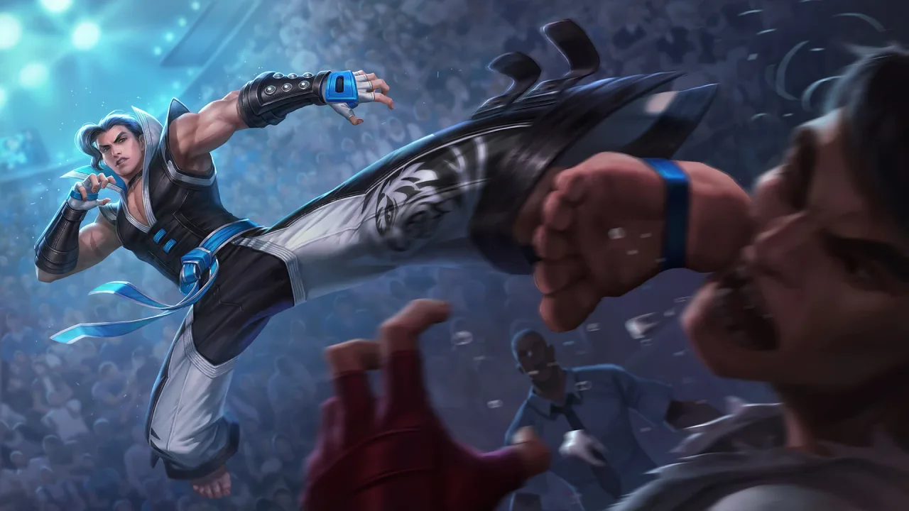

[Тир-лист](https://boostmlbb.ru/heroes/)[Предметы](https://boostmlbb.ru/items/)[Скины](https://boostmlbb.ru/skins/)[Новости и гайды](https://boostmlbb.ru/news/)

[Скины](https://boostmlbb.ru/skins/)/[Чу](https://boostmlbb.ru/skins/chou.html)/Яростный тигр

[Скин Чу](https://boostmlbb.ru/skins/chou.html)

# Яростный тигр

Furious Tiger

Исключительный ExceptionalОсобыйВ продаже

Как получить

Продаётся в магазине обликов за 749 алмазов.

Цена

749 алмазов

Вышел

2018 год

## Что меняет облик

-   Новая внешность
-   Новые эффекты навыков
-   Анимация показа
-   Бонус к характеристикам

## Перекраски

Тот же облик в других цветах. Перекраска открывается, только если у вас уже есть сам облик.

-   **Красный тигр** Red Tiger

## Все скины Чу [11](https://boostmlbb.ru/skins/chou.html)

[ECHOДелюкс · 2023](https://boostmlbb.ru/skins/chou/echo.html)[Дракон СирюДелюкс · 2022](https://boostmlbb.ru/skins/chou/dragon-shiryu.html)[Весы СирюГрандиозный · 2022](https://boostmlbb.ru/skins/chou/libra-shiryu.html)[Чу S.T.U.N.Делюкс · 2021](https://boostmlbb.ru/skins/chou/s-t-u-n-chou.html)[Громовой кулакГрандиозный · 2021](https://boostmlbb.ru/skins/chou/thunderfist.html)[Вне себяИсключительный · 2019](https://boostmlbb.ru/skins/chou/go-ballistic.html)[Иори ЯгамиГрандиозный · 2019](https://boostmlbb.ru/skins/chou/iori-yagami.html)[Яростный тигрИсключительный · 2018](https://boostmlbb.ru/skins/chou/furious-tiger.html)[Король муай-тайОбычный · 2017](https://boostmlbb.ru/skins/chou/king-of-muay-thai.html)[Мальчик-драконИзысканный · 2017](https://boostmlbb.ru/skins/chou/dragon-boy.html)[Хип-хоп пареньОбычный · 2016](https://boostmlbb.ru/skins/chou/hip-hop-boy.html)

## Серия «Особый»

[Тайный вердиктМатильда · 2026](https://boostmlbb.ru/skins/mathilda/arcane-verdict.html)[Вальс на ветруВэйл · 2026](https://boostmlbb.ru/skins/vale/windborne-waltz.html)[Капитан потерянныхФранко · 2026](https://boostmlbb.ru/skins/franco/captain-of-the-lost.html)[ВолнорезЛи Сун-Син · 2025](https://boostmlbb.ru/skins/yi-sun-shin/wavebreaker.html)[Стальные рукиБаданг · 2025](https://boostmlbb.ru/skins/badang/steel-arms.html)[Леди с зонтикомКагура · 2025](https://boostmlbb.ru/skins/kagura/lady-parasol.html)[Ужас пучиныАлдос · 2025](https://boostmlbb.ru/skins/aldous/fathom-terror.html)[Труппа лунного светаЧан'Э · 2025](https://boostmlbb.ru/skins/change/moonglow-troupe.html)

**Поднимем ранг на герое Чу**Цена считается в калькуляторе

[Рассчитать цену](https://boostmlbb.ru/order.html?type=hero)

## Частые вопросы

Как получить скин «Яростный тигр» на Чу?

Продаётся в магазине обликов за 749 алмазов.

Когда вышел скин «Яростный тигр»?

2018 год.

Какой класс у скина «Яростный тигр»?

Исключительный (Exceptional), серия «Особый».
