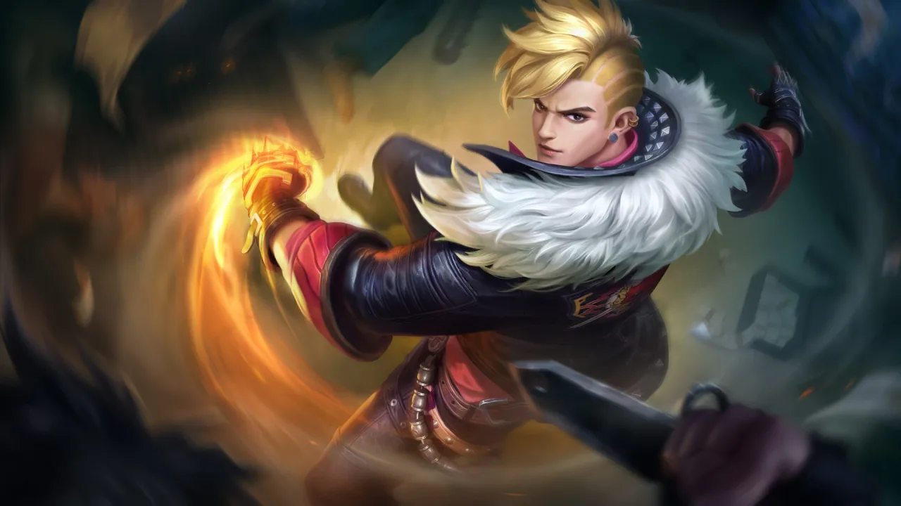

[Тир-лист](https://boostmlbb.ru/heroes/)[Предметы](https://boostmlbb.ru/items/)[Скины](https://boostmlbb.ru/skins/)[Новости и гайды](https://boostmlbb.ru/news/)

[Скины](https://boostmlbb.ru/skins/)/[Чу](https://boostmlbb.ru/skins/chou.html)/Вне себя

[Скин Чу](https://boostmlbb.ru/skins/chou.html)

# Вне себя

Go Ballistic

Исключительный ExceptionalЗвёздный участникОграниченный

Как получить

Награда «Звёздного участника» в августе 2019.

Вышел

1 августа 2019

## Что меняет облик

-   Новая внешность
-   Новые эффекты навыков
-   Анимация показа
-   Бонус к характеристикам

## Все скины Чу [11](https://boostmlbb.ru/skins/chou.html)

[ECHOДелюкс · 2023](https://boostmlbb.ru/skins/chou/echo.html)[Дракон СирюДелюкс · 2022](https://boostmlbb.ru/skins/chou/dragon-shiryu.html)[Весы СирюГрандиозный · 2022](https://boostmlbb.ru/skins/chou/libra-shiryu.html)[Чу S.T.U.N.Делюкс · 2021](https://boostmlbb.ru/skins/chou/s-t-u-n-chou.html)[Громовой кулакГрандиозный · 2021](https://boostmlbb.ru/skins/chou/thunderfist.html)[Вне себяИсключительный · 2019](https://boostmlbb.ru/skins/chou/go-ballistic.html)[Иори ЯгамиГрандиозный · 2019](https://boostmlbb.ru/skins/chou/iori-yagami.html)[Яростный тигрИсключительный · 2018](https://boostmlbb.ru/skins/chou/furious-tiger.html)[Король муай-тайОбычный · 2017](https://boostmlbb.ru/skins/chou/king-of-muay-thai.html)[Мальчик-драконИзысканный · 2017](https://boostmlbb.ru/skins/chou/dragon-boy.html)[Хип-хоп пареньОбычный · 2016](https://boostmlbb.ru/skins/chou/hip-hop-boy.html)

## Серия «Звёздный участник»

[Морячка, рождённая приливомКалеа · 2026](https://boostmlbb.ru/skins/kalea/tideborn-sailor.html)[Тень кицунэХаябуса · 2026](https://boostmlbb.ru/skins/hayabusa/kitsune-s-shadow.html)[Клыки резниХанзо · 2026](https://boostmlbb.ru/skins/hanzo/fangs-of-slaughter.html)[Тлеющая крепостьБелерик · 2026](https://boostmlbb.ru/skins/belerick/smouldering-fortress.html)[Магитех­нический призракОбсидия · 2026](https://boostmlbb.ru/skins/obsidia/magitech-wraith.html)[Элизийское сияниеЦзэтянь · 2026](https://boostmlbb.ru/skins/zetian/elysian-luminance.html)[Батальон стражейХильда · 2026](https://boostmlbb.ru/skins/hilda/guardian-battalion.html)[Мечта­тельный коиХарли · 2026](https://boostmlbb.ru/skins/harley/dreaming-koi.html)

**Поднимем ранг на герое Чу**Цена считается в калькуляторе

[Рассчитать цену](https://boostmlbb.ru/order.html?type=hero)

## Частые вопросы

Как получить скин «Вне себя» на Чу?

Награда «Звёздного участника» в августе 2019.

Когда вышел скин «Вне себя»?

1 августа 2019.

Какой класс у скина «Вне себя»?

Исключительный (Exceptional), серия «Звёздный участник».
