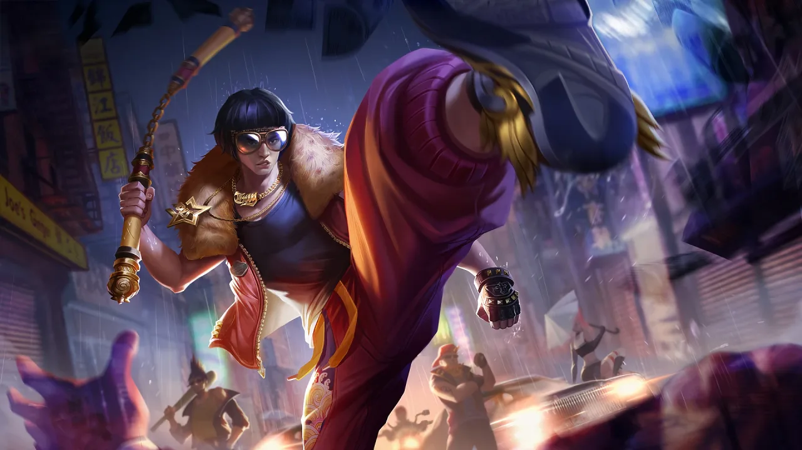

[Скины Чу](https://boostmlbb.ru/skins/chou.html)

[Скины](https://boostmlbb.ru/skins/)/[Чу](https://boostmlbb.ru/skins/chou.html)/Хип-хоп парень

[Скин Чу](https://boostmlbb.ru/skins/chou.html)

# Хип-хоп парень

Hip-hop Boy

Обычный CommonВ продаже

Как получить

Продаётся в магазине обликов за 269 алмазов.

Цена

269 алмазов

Вышел

2016 год

## Что меняет облик

-   Бонус к характеристикам

## Все скины Чу [11](https://boostmlbb.ru/skins/chou.html)

[ECHOДелюкс · 2023](https://boostmlbb.ru/skins/chou/echo.html)[Дракон СирюДелюкс · 2022](https://boostmlbb.ru/skins/chou/dragon-shiryu.html)[Весы СирюГрандиозный · 2022](https://boostmlbb.ru/skins/chou/libra-shiryu.html)[Чу S.T.U.N.Делюкс · 2021](https://boostmlbb.ru/skins/chou/s-t-u-n-chou.html)[Громовой кулакГрандиозный · 2021](https://boostmlbb.ru/skins/chou/thunderfist.html)[Вне себяИсключительный · 2019](https://boostmlbb.ru/skins/chou/go-ballistic.html)[Иори ЯгамиГрандиозный · 2019](https://boostmlbb.ru/skins/chou/iori-yagami.html)[Яростный тигрИсключительный · 2018](https://boostmlbb.ru/skins/chou/furious-tiger.html)[Король муай-тайОбычный · 2017](https://boostmlbb.ru/skins/chou/king-of-muay-thai.html)[Мальчик-драконИзысканный · 2017](https://boostmlbb.ru/skins/chou/dragon-boy.html)[Хип-хоп пареньОбычный · 2016](https://boostmlbb.ru/skins/chou/hip-hop-boy.html)

**Сколько стоит буст на герое Чу?**Выберите текущий и желаемый ранг. Стоимость появится на сайте.

[Рассчитать цену](https://boostmlbb.ru/order.html?type=hero)

## Частые вопросы

Как получить скин «Хип-хоп парень» на Чу?

Продаётся в магазине обликов за 269 алмазов.

Когда вышел скин «Хип-хоп парень»?

2016 год.

Какой класс у скина «Хип-хоп парень»?

Обычный (Common).
