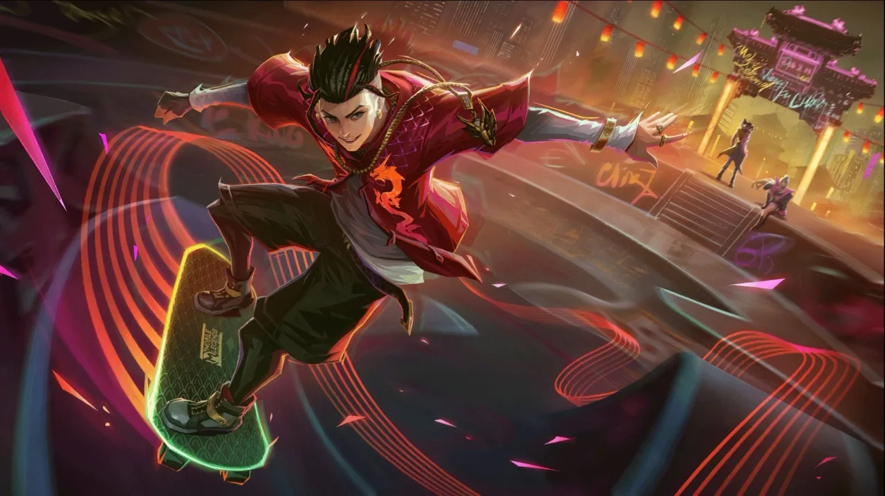
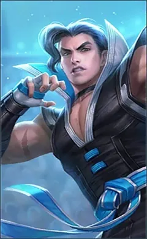

[Скины Чу](https://boostmlbb.ru/skins/chou.html)

[Скины](https://boostmlbb.ru/skins/)/[Чу](https://boostmlbb.ru/skins/chou.html)/Чу S.T.U.N.

[Скин Чу](https://boostmlbb.ru/skins/chou.html)

# Чу S.T.U.N.

S.T.U.N. Chou

Делюкс DeluxeS.T.U.N.Ограниченный

Как получить

Цена на старте: 899 алмазов. Сейчас в магазине не продаётся, возвращается только в событиях.

Цена

899 алмазов

Вышел

апрель 2021

## Что меняет облик

-   Новая внешность
-   Новые эффекты навыков
-   Звуки навыков
-   Своя озвучка
-   Анимация показа
-   Сцена показа
-   Бонус к характеристикам

## Все скины Чу [11](https://boostmlbb.ru/skins/chou.html)

[ECHOДелюкс · 2023](https://boostmlbb.ru/skins/chou/echo.html)[Дракон СирюДелюкс · 2022](https://boostmlbb.ru/skins/chou/dragon-shiryu.html)[Весы СирюГрандиозный · 2022](https://boostmlbb.ru/skins/chou/libra-shiryu.html)[Чу S.T.U.N.Делюкс · 2021](https://boostmlbb.ru/skins/chou/s-t-u-n-chou.html)[Громовой кулакГрандиозный · 2021](https://boostmlbb.ru/skins/chou/thunderfist.html)[Вне себяИсключительный · 2019](https://boostmlbb.ru/skins/chou/go-ballistic.html)[Иори ЯгамиГрандиозный · 2019](https://boostmlbb.ru/skins/chou/iori-yagami.html)[Яростный тигрИсключительный · 2018](https://boostmlbb.ru/skins/chou/furious-tiger.html)[Король муай-тайОбычный · 2017](https://boostmlbb.ru/skins/chou/king-of-muay-thai.html)[Мальчик-драконИзысканный · 2017](https://boostmlbb.ru/skins/chou/dragon-boy.html)[Хип-хоп пареньОбычный · 2016](https://boostmlbb.ru/skins/chou/hip-hop-boy.html)

## Серия «S.T.U.N.»

[Селена S.T.U.N.Селена · 2021](https://boostmlbb.ru/skins/selena/s-t-u-n-selena.html)[Броуди S.T.U.N.Броуди · 2021](https://boostmlbb.ru/skins/brody/s-t-u-n-brody.html)

**Сколько стоит буст на герое Чу?**Выберите текущий и желаемый ранг. Стоимость появится на сайте.

[Рассчитать цену](https://boostmlbb.ru/order.html?type=hero)

## Частые вопросы

Как получить скин «Чу S.T.U.N.» на Чу?

Цена на старте: 899 алмазов. Сейчас в магазине не продаётся, возвращается только в событиях.

Когда вышел скин «Чу S.T.U.N.»?

Апрель 2021.

Какой класс у скина «Чу S.T.U.N.»?

Делюкс (Deluxe), серия «S.T.U.N.».
