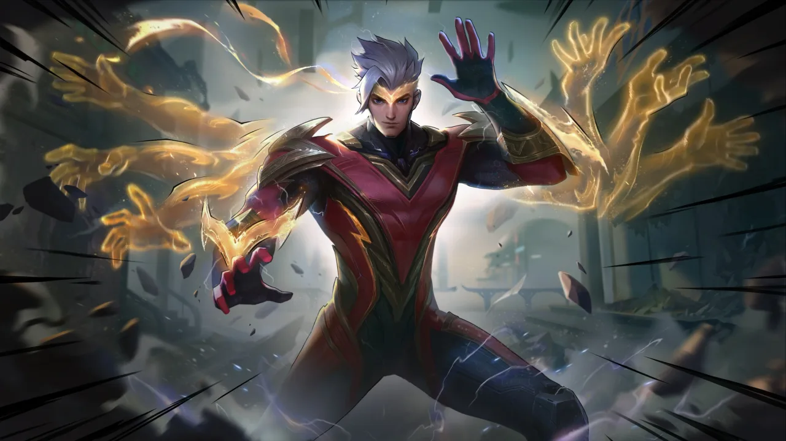
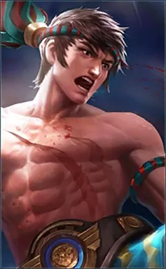

[Тир-лист](https://boostmlbb.ru/heroes/)[Предметы](https://boostmlbb.ru/items/)[Скины](https://boostmlbb.ru/skins/)[Новости и гайды](https://boostmlbb.ru/news/)

[Скины](https://boostmlbb.ru/skins/)/[Чу](https://boostmlbb.ru/skins/chou.html)/Громовой кулак

[Скин Чу](https://boostmlbb.ru/skins/chou.html)

# Громовой кулак

Thunderfist

Грандиозный GrandВосходящие звёздыОграниченный

Как получить

Выходил в событии «Восходящие звёзды». Ограниченные облики иногда возвращаются в розыгрышах событий.

Вышел

2021 год

## Что меняет облик

-   Новая внешность
-   Новые эффекты навыков
-   Звуки навыков
-   Своя озвучка
-   Анимация показа
-   Сцена показа
-   Бонус к характеристикам

## Все скины Чу [11](https://boostmlbb.ru/skins/chou.html)

[ECHOДелюкс · 2023](https://boostmlbb.ru/skins/chou/echo.html)[Дракон СирюДелюкс · 2022](https://boostmlbb.ru/skins/chou/dragon-shiryu.html)[Весы СирюГрандиозный · 2022](https://boostmlbb.ru/skins/chou/libra-shiryu.html)[Чу S.T.U.N.Делюкс · 2021](https://boostmlbb.ru/skins/chou/s-t-u-n-chou.html)[Громовой кулакГрандиозный · 2021](https://boostmlbb.ru/skins/chou/thunderfist.html)[Вне себяИсключительный · 2019](https://boostmlbb.ru/skins/chou/go-ballistic.html)[Иори ЯгамиГрандиозный · 2019](https://boostmlbb.ru/skins/chou/iori-yagami.html)[Яростный тигрИсключительный · 2018](https://boostmlbb.ru/skins/chou/furious-tiger.html)[Король муай-тайОбычный · 2017](https://boostmlbb.ru/skins/chou/king-of-muay-thai.html)[Мальчик-драконИзысканный · 2017](https://boostmlbb.ru/skins/chou/dragon-boy.html)[Хип-хоп пареньОбычный · 2016](https://boostmlbb.ru/skins/chou/hip-hop-boy.html)

## Серия «Восходящие звёзды»

[Мастер мечаЛанселот · 2024](https://boostmlbb.ru/skins/lancelot/swordmaster.html)[Снежная буряВэйл · 2023](https://boostmlbb.ru/skins/vale/blizzard-storm.html)[Прорица­тельницаЭсмеральда · 2023](https://boostmlbb.ru/skins/esmeralda/the-foreseer.html)[Огненный разрядБруно · 2020](https://boostmlbb.ru/skins/bruno/firebolt.html)

**Поднимем ранг на герое Чу**Цена считается в калькуляторе

[Рассчитать цену](https://boostmlbb.ru/order.html?type=hero)

## Частые вопросы

Как получить скин «Громовой кулак» на Чу?

Выходил в событии «Восходящие звёзды». Ограниченные облики иногда возвращаются в розыгрышах событий.

Когда вышел скин «Громовой кулак»?

2021 год.

Какой класс у скина «Громовой кулак»?

Грандиозный (Grand), серия «Восходящие звёзды».
