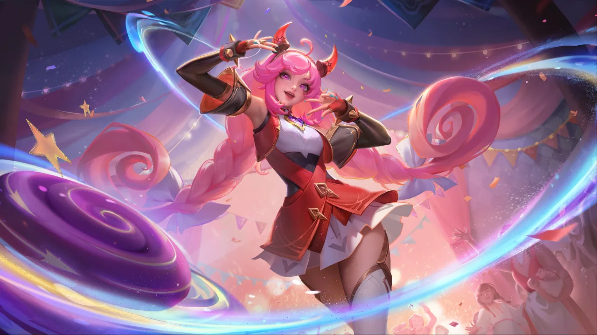
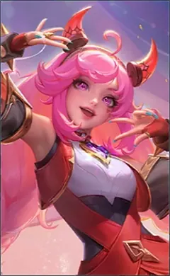

[Скины Чичи](https://boostmlbb.ru/skins/cici.html)

[Скины](https://boostmlbb.ru/skins/)/[Чичи](https://boostmlbb.ru/skins/cici.html)/Причудливый карнавал

[Скин Чичи](https://boostmlbb.ru/skins/cici.html)

# Причудливый карнавал

Whimsical Carnival

Обычный CommonВ продаже

Как получить

Продаётся в магазине обликов за 269 алмазов.

Цена

269 алмазов

Вышел

27 декабря 2023

## Что меняет облик

-   Бонус к характеристикам

## Все скины Чичи [3](https://boostmlbb.ru/skins/cici.html)

[Чичи P.ACEДелюкс · 2025](https://boostmlbb.ru/skins/cici/p-ace-cici.html)[Цирковая грезаИсключительный · 2025](https://boostmlbb.ru/skins/cici/circus-reverie.html)[Причуд­ливый карнавалОбычный · 2023](https://boostmlbb.ru/skins/cici/whimsical-carnival.html)

**Сколько стоит буст на герое Чичи?**Выберите текущий и желаемый ранг. Стоимость появится на сайте.

[Рассчитать цену](https://boostmlbb.ru/order.html?type=hero)

## Частые вопросы

Как получить скин «Причудливый карнавал» на Чичи?

Продаётся в магазине обликов за 269 алмазов.

Когда вышел скин «Причудливый карнавал»?

27 декабря 2023.

Какой класс у скина «Причудливый карнавал»?

Обычный (Common).
