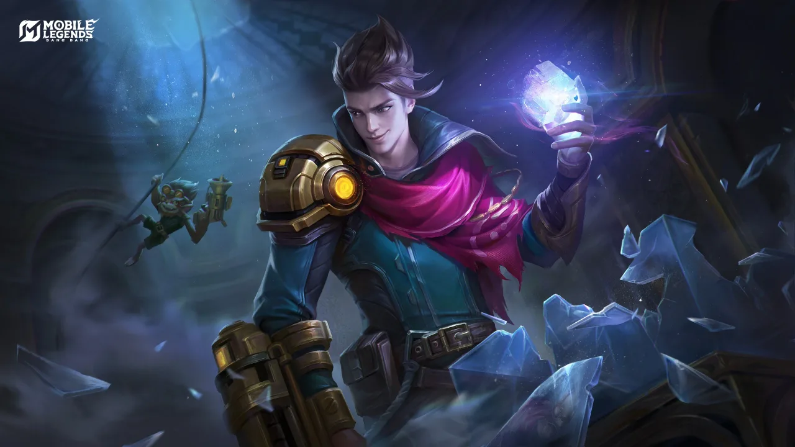

[Тир-лист](https://boostmlbb.ru/heroes/)[Предметы](https://boostmlbb.ru/items/)[Скины](https://boostmlbb.ru/skins/)[Новости и гайды](https://boostmlbb.ru/news/)

[Скины](https://boostmlbb.ru/skins/)/Клауд

# Скины Клауда

Скинов

11

Можно купить

3

Последний

[Мехадракон](https://boostmlbb.ru/skins/claude/mecha-dragon.html)2025

[Профиль героя→](https://boostmlbb.ru/heroes/claude.html)

## Все скины

ВсеГрандиозныйИзысканныйДелюксИсключительныйОбычный

[МехадраконИзысканный · 2025](https://boostmlbb.ru/skins/claude/mecha-dragon.html)[Косми­ческое пламяГрандиозный · 2024](https://boostmlbb.ru/skins/claude/cosmic-blaze.html)[Искра претен­дентаДелюкс · 2024](https://boostmlbb.ru/skins/claude/challenger-s-spark.html)[Пылающее сердцеДелюкс · 2024](https://boostmlbb.ru/skins/claude/heart-aflame.html)[Пылающий следДелюкс · 2024](https://boostmlbb.ru/skins/claude/blazing-trace.html)[Сильнейший на ЗемлеИсключительный · 2024](https://boostmlbb.ru/skins/claude/earth-s-mightiest.html)[Рож­дественский карнавалИсключительный · 2024](https://boostmlbb.ru/skins/claude/christmas-carnival.html)[Спаса­тельницаИсключительный · 2024](https://boostmlbb.ru/skins/claude/lifeguard.html)[Золотая пуляОбычный · 2022](https://boostmlbb.ru/skins/claude/golden-bullet.html)[Плохой броГрандиозный · 2020](https://boostmlbb.ru/skins/claude/bad-bro.html)[Пират-грабительИсключительный · 2018](https://boostmlbb.ru/skins/claude/plunderous-pirate.html)

**Поднимем ранг на герое Клауд**Цена считается в калькуляторе

[Рассчитать цену](https://boostmlbb.ru/order.html?type=hero)

## Частые вопросы

Сколько скинов у Клауда?

11 скинов без стандартного облика. Последний — «Мехадракон» (Mecha Dragon), 3 апреля 2025.

Какие скины Клауда можно купить сейчас?

«Пылающий след» (899 алмазов), «Спасательница» (749 алмазов), «Золотая пуля» (269 алмазов). Остальные облики ограниченные и возвращаются только в событиях.

Какой самый редкий скин Клауда?

«Космическое пламя» (Cosmic Blaze), класс грандиозный, серия «PRIME». Выходил в событии «PRIME». Ограниченные облики иногда возвращаются в розыгрышах событий.
