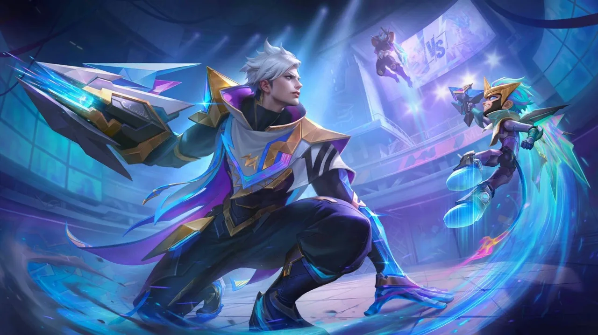

[Тир-лист](https://boostmlbb.ru/heroes/)[Предметы](https://boostmlbb.ru/items/)[Скины](https://boostmlbb.ru/skins/)[Новости и гайды](https://boostmlbb.ru/news/)

[Скины](https://boostmlbb.ru/skins/)/[Клауд](https://boostmlbb.ru/skins/claude.html)/Искра претендента

[Скин Клауда](https://boostmlbb.ru/skins/claude.html)

# Искра претендента

Challenger's Spark

Делюкс DeluxeЧемпионат мира M6Ограниченный

Как получить

Награда пропуска M6.

Вышел

16 марта 2024

## Что меняет облик

-   Новая внешность
-   Новые эффекты навыков
-   Звуки навыков
-   Своя озвучка
-   Анимация показа
-   Сцена показа
-   Музыка показа
-   Бонус к характеристикам

## Все скины Клауда [11](https://boostmlbb.ru/skins/claude.html)

[МехадраконИзысканный · 2025](https://boostmlbb.ru/skins/claude/mecha-dragon.html)[Косми­ческое пламяГрандиозный · 2024](https://boostmlbb.ru/skins/claude/cosmic-blaze.html)[Искра претен­дентаДелюкс · 2024](https://boostmlbb.ru/skins/claude/challenger-s-spark.html)[Пылающее сердцеДелюкс · 2024](https://boostmlbb.ru/skins/claude/heart-aflame.html)[Пылающий следДелюкс · 2024](https://boostmlbb.ru/skins/claude/blazing-trace.html)[Сильнейший на ЗемлеИсключительный · 2024](https://boostmlbb.ru/skins/claude/earth-s-mightiest.html)[Рож­дественский карнавалИсключительный · 2024](https://boostmlbb.ru/skins/claude/christmas-carnival.html)[Спаса­тельницаИсключительный · 2024](https://boostmlbb.ru/skins/claude/lifeguard.html)[Золотая пуляОбычный · 2022](https://boostmlbb.ru/skins/claude/golden-bullet.html)[Плохой броГрандиозный · 2020](https://boostmlbb.ru/skins/claude/bad-bro.html)[Пират-грабительИсключительный · 2018](https://boostmlbb.ru/skins/claude/plunderous-pirate.html)

**Поднимем ранг на герое Клауд**Цена считается в калькуляторе

[Рассчитать цену](https://boostmlbb.ru/order.html?type=hero)

## Частые вопросы

Как получить скин «Искра претендента» на Клауда?

Награда пропуска M6.

Когда вышел скин «Искра претендента»?

16 марта 2024.

Какой класс у скина «Искра претендента»?

Делюкс (Deluxe), серия «Чемпионат мира M6».
