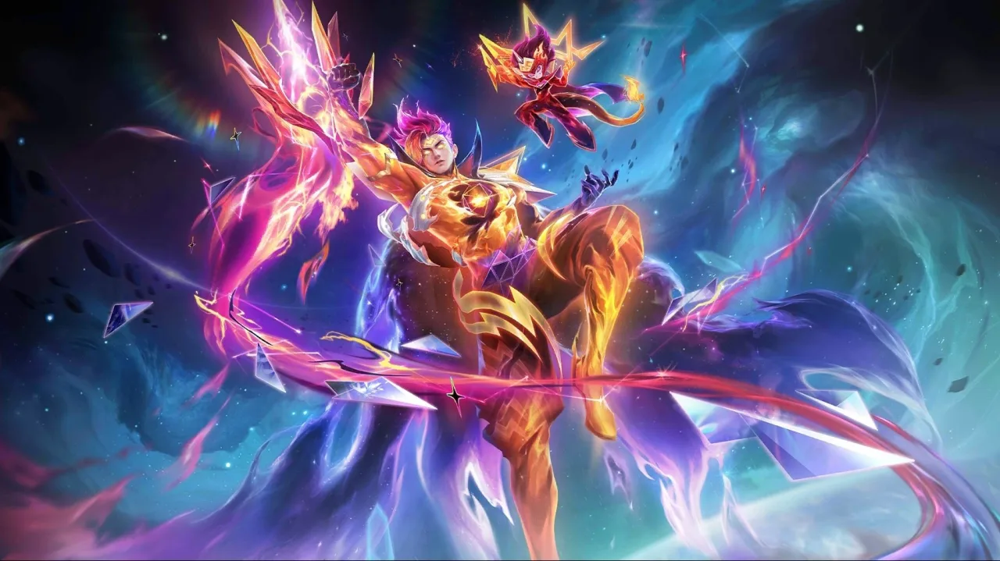

[Скины Клауда](https://boostmlbb.ru/skins/claude.html)

[Скины](https://boostmlbb.ru/skins/)/[Клауд](https://boostmlbb.ru/skins/claude.html)/Космическое пламя

[Скин Клауда](https://boostmlbb.ru/skins/claude.html)

# Космическое пламя

Cosmic Blaze

Грандиозный GrandPRIMEОграниченный

Как получить

Выходил в событии «PRIME». Ограниченные облики иногда возвращаются в розыгрышах событий.

Вышел

16 марта 2024

## Что меняет облик

-   Новая внешность
-   Новые эффекты навыков
-   Звуки навыков
-   Своя озвучка
-   Иконки навыков
-   Анимация показа
-   Сцена показа
-   Музыка показа
-   Анимация появления
-   Особые действия
-   Яркие спецэффекты
-   Бонус к характеристикам

## Все скины Клауда [11](https://boostmlbb.ru/skins/claude.html)

[МехадраконИзысканный · 2025](https://boostmlbb.ru/skins/claude/mecha-dragon.html)[Косми­ческое пламяГрандиозный · 2024](https://boostmlbb.ru/skins/claude/cosmic-blaze.html)[Искра претен­дентаДелюкс · 2024](https://boostmlbb.ru/skins/claude/challenger-s-spark.html)[Пылающее сердцеДелюкс · 2024](https://boostmlbb.ru/skins/claude/heart-aflame.html)[Пылающий следДелюкс · 2024](https://boostmlbb.ru/skins/claude/blazing-trace.html)[Сильнейший на ЗемлеИсключительный · 2024](https://boostmlbb.ru/skins/claude/earth-s-mightiest.html)[Рож­дественский карнавалИсключительный · 2024](https://boostmlbb.ru/skins/claude/christmas-carnival.html)[Спаса­тельницаИсключительный · 2024](https://boostmlbb.ru/skins/claude/lifeguard.html)[Золотая пуляОбычный · 2022](https://boostmlbb.ru/skins/claude/golden-bullet.html)[Плохой броГрандиозный · 2020](https://boostmlbb.ru/skins/claude/bad-bro.html)[Пират-грабительИсключительный · 2018](https://boostmlbb.ru/skins/claude/plunderous-pirate.html)

## Серия «PRIME»

[Косми­ческий драконЧонг · 2023](https://boostmlbb.ru/skins/yu-zhong/cosmic-dragon.html)[Звёздный блескБеатрис · 2022](https://boostmlbb.ru/skins/beatrix/stellar-briliance.html)[Охотник на нечистьРоджер · 2021](https://boostmlbb.ru/skins/roger/fiend-hunter.html)[Косми­ческий финалГрейнджер](https://boostmlbb.ru/skins/granger/cosmic-finality.html)

**Сколько стоит буст на герое Клауд?**Выберите текущий и желаемый ранг. Стоимость появится на сайте.

[Рассчитать цену](https://boostmlbb.ru/order.html?type=hero)

## Частые вопросы

Как получить скин «Космическое пламя» на Клауда?

Выходил в событии «PRIME». Ограниченные облики иногда возвращаются в розыгрышах событий.

Когда вышел скин «Космическое пламя»?

16 марта 2024.

Какой класс у скина «Космическое пламя»?

Грандиозный (Grand), серия «PRIME».
