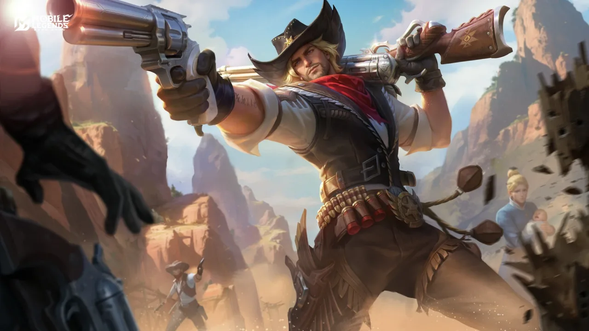

[Тир-лист](https://boostmlbb.ru/heroes/)[Предметы](https://boostmlbb.ru/items/)[Скины](https://boostmlbb.ru/skins/)[Новости и гайды](https://boostmlbb.ru/news/)

[Скины](https://boostmlbb.ru/skins/)/Клинт

# Скины Клинта

Скинов

12

Можно купить

4

Последний

[Алый мушкетёр](https://boostmlbb.ru/skins/clint/scarlet-musketeer.html)2026

[Профиль героя→](https://boostmlbb.ru/heroes/clint.html)

## Все скины

ВсеИзысканныйДелюксИсключительныйОбычный

[Алый мушкетёрОбычный · 2026](https://boostmlbb.ru/skins/clint/scarlet-musketeer.html)[Пасть драконаДелюкс · 2024](https://boostmlbb.ru/skins/clint/dragon-s-maw.html)[Капитан рифовДелюкс · 2024](https://boostmlbb.ru/skins/clint/captain-of-the-reefs.html)[Багровый залпИзысканный · 2023](https://boostmlbb.ru/skins/clint/crimson-blast.html)[Оператор CLИсключительный · 2022](https://boostmlbb.ru/skins/clint/operator-cl.html)[Теневое знамениеДелюкс · 2020](https://boostmlbb.ru/skins/clint/shadow-omen.html)[Охотник на ведьмОбычный · 2020](https://boostmlbb.ru/skins/clint/witch-hunter.html)[Чемпион по бадминтонуИсключительный · 2019](https://boostmlbb.ru/skins/clint/badminton-champion.html)[Рок-н-роллИсключительный · 2017](https://boostmlbb.ru/skins/clint/rock-and-roll.html)[Пушки и розыИсключительный · 2017](https://boostmlbb.ru/skins/clint/guns-and-roses.html)[Солнце и песокИсключительный · 2016](https://boostmlbb.ru/skins/clint/sun-n-sand.html)[Сосуд разрушения](https://boostmlbb.ru/skins/clint/vessel-of-ruin.html)

**Поднимем ранг на герое Клинт**Цена считается в калькуляторе

[Рассчитать цену](https://boostmlbb.ru/order.html?type=hero)

## Частые вопросы

Сколько скинов у Клинта?

12 скинов без стандартного облика. Последний — «Алый мушкетёр» (Scarlet Musketeer), 16 сентября 2026.

Какие скины Клинта можно купить сейчас?

«Алый мушкетёр» (269 алмазов), «Капитан рифов» (899 алмазов), «Чемпион по бадминтону» (749 алмазов), «Солнце и песок» (399 алмазов). Остальные облики ограниченные и возвращаются только в событиях.

Какой самый редкий скин Клинта?

«Багровый залп» (Crimson Blast), класс изысканный, серия «Коллекционный». Главный приз розыгрыша в коллекционном событии, попытки покупаются за алмазы. Ограниченные облики иногда возвращаются в розыгрышах событий.
