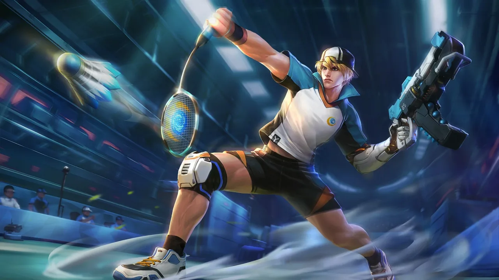

[Скины Клинта](https://boostmlbb.ru/skins/clint.html)

[Скины](https://boostmlbb.ru/skins/)/[Клинт](https://boostmlbb.ru/skins/clint.html)/Чемпион по бадминтону

[Скин Клинта](https://boostmlbb.ru/skins/clint.html)

# Чемпион по бадминтону

Badminton Champion

Исключительный ExceptionalОсобыйВ продаже

Как получить

Продаётся в магазине обликов за 749 алмазов.

Цена

749 алмазов

Вышел

2019 год

## Что меняет облик

-   Новая внешность
-   Новые эффекты навыков
-   Анимация показа
-   Бонус к характеристикам

## Перекраски

Тот же облик в других цветах. Перекраска открывается, только если у вас уже есть сам облик.

-   **Полный смэш** Full SmashНаграда «Звёздного участника» в июле 2021.

## Все скины Клинта [12](https://boostmlbb.ru/skins/clint.html)

[Алый мушкетёрОбычный · 2026](https://boostmlbb.ru/skins/clint/scarlet-musketeer.html)[Пасть драконаДелюкс · 2024](https://boostmlbb.ru/skins/clint/dragon-s-maw.html)[Капитан рифовДелюкс · 2024](https://boostmlbb.ru/skins/clint/captain-of-the-reefs.html)[Багровый залпИзысканный · 2023](https://boostmlbb.ru/skins/clint/crimson-blast.html)[Оператор CLИсключительный · 2022](https://boostmlbb.ru/skins/clint/operator-cl.html)[Теневое знамениеДелюкс · 2020](https://boostmlbb.ru/skins/clint/shadow-omen.html)[Охотник на ведьмОбычный · 2020](https://boostmlbb.ru/skins/clint/witch-hunter.html)[Чемпион по бадминтонуИсключительный · 2019](https://boostmlbb.ru/skins/clint/badminton-champion.html)[Рок-н-роллИсключительный · 2017](https://boostmlbb.ru/skins/clint/rock-and-roll.html)[Пушки и розыИсключительный · 2017](https://boostmlbb.ru/skins/clint/guns-and-roses.html)[Солнце и песокИсключительный · 2016](https://boostmlbb.ru/skins/clint/sun-n-sand.html)[Сосуд разрушения](https://boostmlbb.ru/skins/clint/vessel-of-ruin.html)

## Серия «Особый»

[Тайный вердиктМатильда · 2026](https://boostmlbb.ru/skins/mathilda/arcane-verdict.html)[Вальс на ветруВэйл · 2026](https://boostmlbb.ru/skins/vale/windborne-waltz.html)[Капитан потерянныхФранко · 2026](https://boostmlbb.ru/skins/franco/captain-of-the-lost.html)[ВолнорезЛи Сун-Син · 2025](https://boostmlbb.ru/skins/yi-sun-shin/wavebreaker.html)[Стальные рукиБаданг · 2025](https://boostmlbb.ru/skins/badang/steel-arms.html)[Леди с зонтикомКагура · 2025](https://boostmlbb.ru/skins/kagura/lady-parasol.html)[Ужас пучиныАлдос · 2025](https://boostmlbb.ru/skins/aldous/fathom-terror.html)[Труппа лунного светаЧан'Э · 2025](https://boostmlbb.ru/skins/change/moonglow-troupe.html)

**Сколько стоит буст на герое Клинт?**Выберите текущий и желаемый ранг. Стоимость появится на сайте.

[Рассчитать цену](https://boostmlbb.ru/order.html?type=hero)

## Частые вопросы

Как получить скин «Чемпион по бадминтону» на Клинта?

Продаётся в магазине обликов за 749 алмазов.

Когда вышел скин «Чемпион по бадминтону»?

2019 год.

Какой класс у скина «Чемпион по бадминтону»?

Исключительный (Exceptional), серия «Особый».
