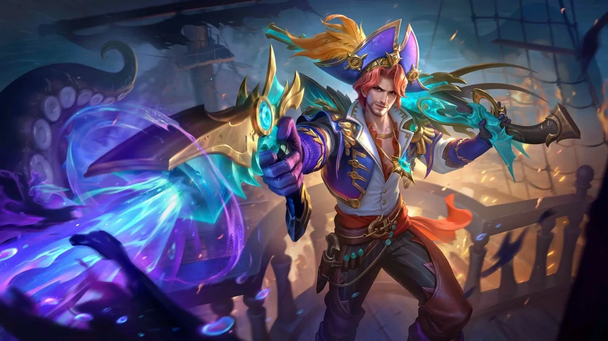

[Тир-лист](https://boostmlbb.ru/heroes/)[Предметы](https://boostmlbb.ru/items/)[Скины](https://boostmlbb.ru/skins/)[Новости и гайды](https://boostmlbb.ru/news/)

[Скины](https://boostmlbb.ru/skins/)/[Клинт](https://boostmlbb.ru/skins/clint.html)/Капитан рифов

[Скин Клинта](https://boostmlbb.ru/skins/clint.html)

# Капитан рифов

Captain of the Reefs

Делюкс DeluxeЭпическийВ продаже

Как получить

Продаётся в магазине обликов за 899 алмазов.

Цена

899 алмазов

Вышел

2024 год

## Что меняет облик

-   Новая внешность
-   Новые эффекты навыков
-   Звуки навыков
-   Анимация показа
-   Сцена показа
-   Музыка показа
-   Бонус к характеристикам

## Все скины Клинта [12](https://boostmlbb.ru/skins/clint.html)

[Алый мушкетёрОбычный · 2026](https://boostmlbb.ru/skins/clint/scarlet-musketeer.html)[Пасть драконаДелюкс · 2024](https://boostmlbb.ru/skins/clint/dragon-s-maw.html)[Капитан рифовДелюкс · 2024](https://boostmlbb.ru/skins/clint/captain-of-the-reefs.html)[Багровый залпИзысканный · 2023](https://boostmlbb.ru/skins/clint/crimson-blast.html)[Оператор CLИсключительный · 2022](https://boostmlbb.ru/skins/clint/operator-cl.html)[Теневое знамениеДелюкс · 2020](https://boostmlbb.ru/skins/clint/shadow-omen.html)[Охотник на ведьмОбычный · 2020](https://boostmlbb.ru/skins/clint/witch-hunter.html)[Чемпион по бадминтонуИсключительный · 2019](https://boostmlbb.ru/skins/clint/badminton-champion.html)[Рок-н-роллИсключительный · 2017](https://boostmlbb.ru/skins/clint/rock-and-roll.html)[Пушки и розыИсключительный · 2017](https://boostmlbb.ru/skins/clint/guns-and-roses.html)[Солнце и песокИсключительный · 2016](https://boostmlbb.ru/skins/clint/sun-n-sand.html)[Сосуд разрушения](https://boostmlbb.ru/skins/clint/vessel-of-ruin.html)

## Серия «Эпический»

[Надзи­ратель преис­поднейМинотавр · 2026](https://boostmlbb.ru/skins/minotaur/nether-overseer.html)[Затонувшее проклятиеАтлас · 2026](https://boostmlbb.ru/skins/atlas/sunken-curse.html)[Вечная клятваВексана · 2026](https://boostmlbb.ru/skins/vexana/eternal-vow.html)[Проклятый свитокХуфра · 2025](https://boostmlbb.ru/skins/khufra/cursed-scroll.html)[Охотница за душамиНаталья · 2025](https://boostmlbb.ru/skins/natalia/soul-huntress.html)[Граф кошмаровЛеоморд · 2025](https://boostmlbb.ru/skins/leomord/nightmare-count.html)[Вершитель звёздБелерик · 2025](https://boostmlbb.ru/skins/belerick/arbiter-of-stars.html)[Хранитель ветровВэйл · 2025](https://boostmlbb.ru/skins/vale/keeper-of-the-winds.html)

**Поднимем ранг на герое Клинт**Цена считается в калькуляторе

[Рассчитать цену](https://boostmlbb.ru/order.html?type=hero)

## Частые вопросы

Как получить скин «Капитан рифов» на Клинта?

Продаётся в магазине обликов за 899 алмазов.

Когда вышел скин «Капитан рифов»?

2024 год.

Какой класс у скина «Капитан рифов»?

Делюкс (Deluxe), серия «Эпический».
