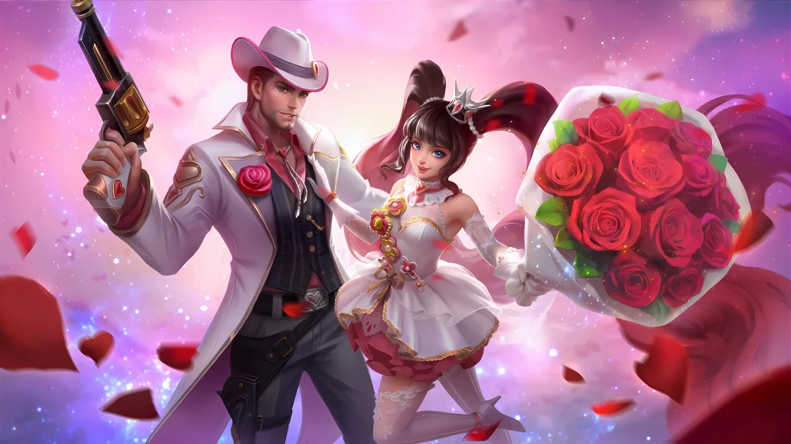

[Тир-лист](https://boostmlbb.ru/heroes/)[Предметы](https://boostmlbb.ru/items/)[Скины](https://boostmlbb.ru/skins/)[Новости и гайды](https://boostmlbb.ru/news/)

[Скины](https://boostmlbb.ru/skins/)/[Клинт](https://boostmlbb.ru/skins/clint.html)/Пушки и розы

[Скин Клинта](https://boostmlbb.ru/skins/clint.html)

# Пушки и розы

Guns and Roses

Исключительный ExceptionalДень святого ВалентинаОграниченный

Как получить

Выходил в магазине обликов во время события. Ограниченные облики иногда возвращаются в розыгрышах событий.

Вышел

2017 год

## Что меняет облик

-   Новая внешность
-   Новые эффекты навыков
-   Анимация показа
-   Сцена показа
-   Бонус к характеристикам

## Все скины Клинта [12](https://boostmlbb.ru/skins/clint.html)

[Алый мушкетёрОбычный · 2026](https://boostmlbb.ru/skins/clint/scarlet-musketeer.html)[Пасть драконаДелюкс · 2024](https://boostmlbb.ru/skins/clint/dragon-s-maw.html)[Капитан рифовДелюкс · 2024](https://boostmlbb.ru/skins/clint/captain-of-the-reefs.html)[Багровый залпИзысканный · 2023](https://boostmlbb.ru/skins/clint/crimson-blast.html)[Оператор CLИсключительный · 2022](https://boostmlbb.ru/skins/clint/operator-cl.html)[Теневое знамениеДелюкс · 2020](https://boostmlbb.ru/skins/clint/shadow-omen.html)[Охотник на ведьмОбычный · 2020](https://boostmlbb.ru/skins/clint/witch-hunter.html)[Чемпион по бадминтонуИсключительный · 2019](https://boostmlbb.ru/skins/clint/badminton-champion.html)[Рок-н-роллИсключительный · 2017](https://boostmlbb.ru/skins/clint/rock-and-roll.html)[Пушки и розыИсключительный · 2017](https://boostmlbb.ru/skins/clint/guns-and-roses.html)[Солнце и песокИсключительный · 2016](https://boostmlbb.ru/skins/clint/sun-n-sand.html)[Сосуд разрушения](https://boostmlbb.ru/skins/clint/vessel-of-ruin.html)

## Серия «День святого Валентина»

[Пылающее сердцеКлауд · 2024](https://boostmlbb.ru/skins/claude/heart-aflame.html)[Манящая загадкаГрейнджер · 2024](https://boostmlbb.ru/skins/granger/alluring-enigma.html)[Манящая мистикаСильвана · 2024](https://boostmlbb.ru/skins/silvanna/alluring-mystique.html)[Джентльмен-ворХуфра · 2023](https://boostmlbb.ru/skins/khufra/gentleman-thief.html)[Парящее сердцеФанни · 2022](https://boostmlbb.ru/skins/fanny/heart-afloat.html)[Призрачная графиняКармилла · 2021](https://boostmlbb.ru/skins/carmilla/phantom-countess.html)[Призрачный графСесилион · 2021](https://boostmlbb.ru/skins/cecilion/phantom-count.html)[Леди-воровкаЭсмеральда · 2020](https://boostmlbb.ru/skins/esmeralda/lady-thief.html)

**Поднимем ранг на герое Клинт**Цена считается в калькуляторе

[Рассчитать цену](https://boostmlbb.ru/order.html?type=hero)

## Частые вопросы

Как получить скин «Пушки и розы» на Клинта?

Выходил в магазине обликов во время события. Ограниченные облики иногда возвращаются в розыгрышах событий.

Когда вышел скин «Пушки и розы»?

2017 год.

Какой класс у скина «Пушки и розы»?

Исключительный (Exceptional), серия «День святого Валентина».
