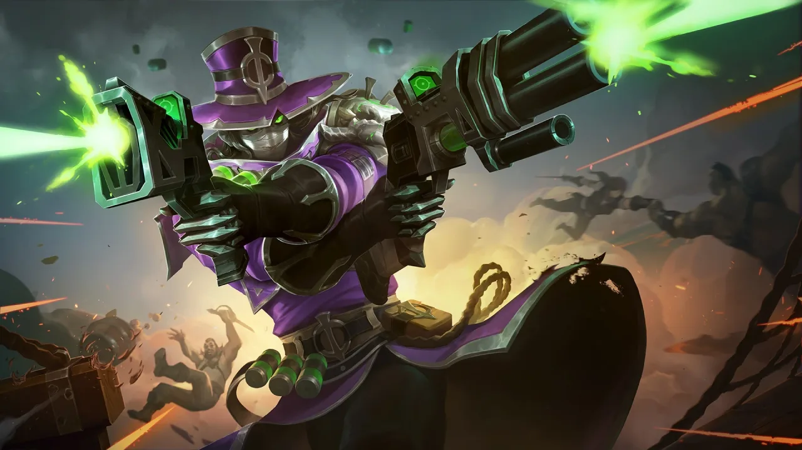

[Скины Клинта](https://boostmlbb.ru/skins/clint.html)

[Скины](https://boostmlbb.ru/skins/)/[Клинт](https://boostmlbb.ru/skins/clint.html)/Охотник на ведьм

[Скин Клинта](https://boostmlbb.ru/skins/clint.html)

# Охотник на ведьм

Witch Hunter

Обычный CommonСезон 15Ограниченный

Как получить

Награда за рейтинговый сезон 15.

Вышел

2020 год

## Что меняет облик

-   Новая внешность
-   Другой цвет эффектов
-   Анимация показа
-   Бонус к характеристикам

## Все скины Клинта [12](https://boostmlbb.ru/skins/clint.html)

[Алый мушкетёрОбычный · 2026](https://boostmlbb.ru/skins/clint/scarlet-musketeer.html)[Пасть драконаДелюкс · 2024](https://boostmlbb.ru/skins/clint/dragon-s-maw.html)[Капитан рифовДелюкс · 2024](https://boostmlbb.ru/skins/clint/captain-of-the-reefs.html)[Багровый залпИзысканный · 2023](https://boostmlbb.ru/skins/clint/crimson-blast.html)[Оператор CLИсключительный · 2022](https://boostmlbb.ru/skins/clint/operator-cl.html)[Теневое знамениеДелюкс · 2020](https://boostmlbb.ru/skins/clint/shadow-omen.html)[Охотник на ведьмОбычный · 2020](https://boostmlbb.ru/skins/clint/witch-hunter.html)[Чемпион по бадминтонуИсключительный · 2019](https://boostmlbb.ru/skins/clint/badminton-champion.html)[Рок-н-роллИсключительный · 2017](https://boostmlbb.ru/skins/clint/rock-and-roll.html)[Пушки и розыИсключительный · 2017](https://boostmlbb.ru/skins/clint/guns-and-roses.html)[Солнце и песокИсключительный · 2016](https://boostmlbb.ru/skins/clint/sun-n-sand.html)[Сосуд разрушения](https://boostmlbb.ru/skins/clint/vessel-of-ruin.html)

**Сколько стоит буст на герое Клинт?**Выберите текущий и желаемый ранг. Стоимость появится на сайте.

[Рассчитать цену](https://boostmlbb.ru/order.html?type=hero)

## Частые вопросы

Как получить скин «Охотник на ведьм» на Клинта?

Награда за рейтинговый сезон 15.

Когда вышел скин «Охотник на ведьм»?

2020 год.

Какой класс у скина «Охотник на ведьм»?

Обычный (Common), серия «Сезон 15».
