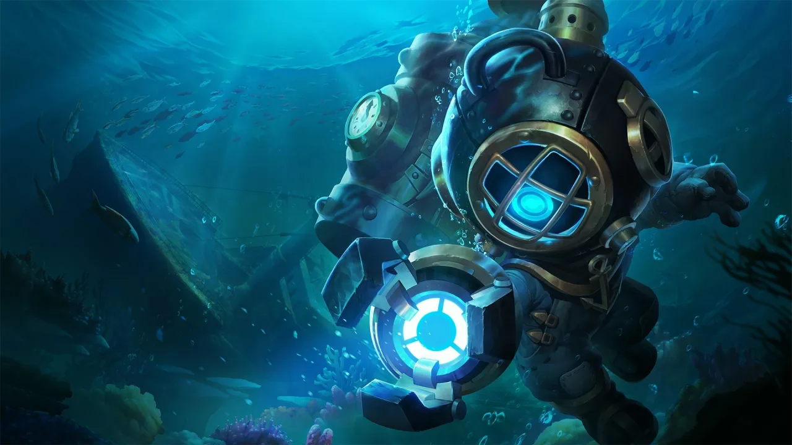

[Тир-лист](https://boostmlbb.ru/heroes/)[Предметы](https://boostmlbb.ru/items/)[Скины](https://boostmlbb.ru/skins/)[Новости и гайды](https://boostmlbb.ru/news/)

[Скины](https://boostmlbb.ru/skins/)/[Циклоп](https://boostmlbb.ru/skins/cyclops.html)/Глубоководный спасатель

[Скин Циклопа](https://boostmlbb.ru/skins/cyclops.html)

# Глубоководный спасатель

Deep Sea Rescuer

Исключительный ExceptionalЗвёздный участникОграниченный

Как получить

Награда «Звёздного участника» в сентябре 2018.

Вышел

1 сентября 2018

## Что меняет облик

-   Новая внешность
-   Новые эффекты навыков
-   Анимация показа
-   Сцена показа
-   Бонус к характеристикам

## Все скины Циклопа [9](https://boostmlbb.ru/skins/cyclops.html)

[Губка БобДелюкс · 2025](https://boostmlbb.ru/skins/cyclops/spongebob.html)[Чернок­нижник-ёкайИзысканный · 2023](https://boostmlbb.ru/skins/cyclops/yokai-warlock.html)[Соломенная куклаИсключительный · 2021](https://boostmlbb.ru/skins/cyclops/straw-doll.html)[Мастер ЙодаГрандиозный · 2021](https://boostmlbb.ru/skins/cyclops/master-yoda.html)[Глубоко­водный спасательИсключительный · 2018](https://boostmlbb.ru/skins/cyclops/deep-sea-rescuer.html)[Зомби-малышОбычный · 2018](https://boostmlbb.ru/skins/cyclops/zombie-bambino.html)[Каратель S.A.B.E.R.Делюкс · 2018](https://boostmlbb.ru/skins/cyclops/s-a-b-e-r-enforcer.html)[Супер-искатель приклю­ченийОбычный · 2017](https://boostmlbb.ru/skins/cyclops/super-adventurer.html)[ЭкзорцистОбычный · 2017](https://boostmlbb.ru/skins/cyclops/exorcist.html)

## Серия «Звёздный участник»

[Морячка, рождённая приливомКалеа · 2026](https://boostmlbb.ru/skins/kalea/tideborn-sailor.html)[Тень кицунэХаябуса · 2026](https://boostmlbb.ru/skins/hayabusa/kitsune-s-shadow.html)[Клыки резниХанзо · 2026](https://boostmlbb.ru/skins/hanzo/fangs-of-slaughter.html)[Тлеющая крепостьБелерик · 2026](https://boostmlbb.ru/skins/belerick/smouldering-fortress.html)[Магитех­нический призракОбсидия · 2026](https://boostmlbb.ru/skins/obsidia/magitech-wraith.html)[Элизийское сияниеЦзэтянь · 2026](https://boostmlbb.ru/skins/zetian/elysian-luminance.html)[Батальон стражейХильда · 2026](https://boostmlbb.ru/skins/hilda/guardian-battalion.html)[Мечта­тельный коиХарли · 2026](https://boostmlbb.ru/skins/harley/dreaming-koi.html)

**Поднимем ранг на герое Циклоп**Цена считается в калькуляторе

[Рассчитать цену](https://boostmlbb.ru/order.html?type=hero)

## Частые вопросы

Как получить скин «Глубоководный спасатель» на Циклопа?

Награда «Звёздного участника» в сентябре 2018.

Когда вышел скин «Глубоководный спасатель»?

1 сентября 2018.

Какой класс у скина «Глубоководный спасатель»?

Исключительный (Exceptional), серия «Звёздный участник».
