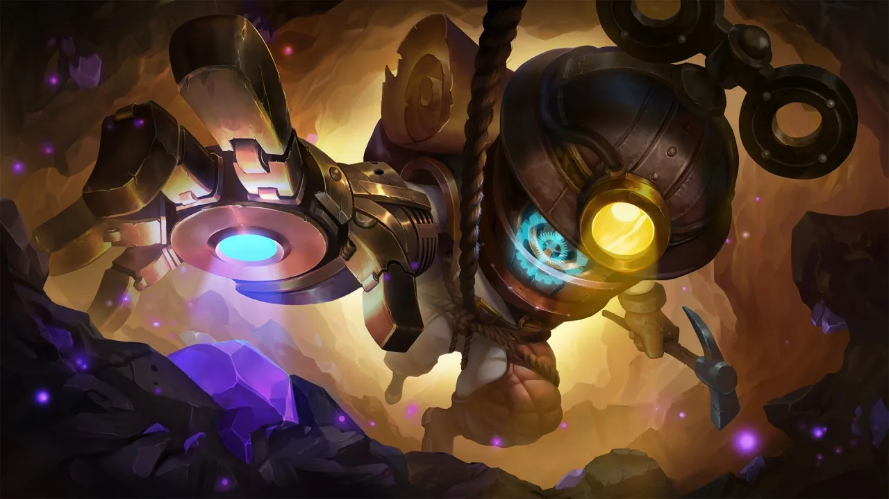

[Тир-лист](https://boostmlbb.ru/heroes/)[Предметы](https://boostmlbb.ru/items/)[Скины](https://boostmlbb.ru/skins/)[Новости и гайды](https://boostmlbb.ru/news/)

[Скины](https://boostmlbb.ru/skins/)/[Циклоп](https://boostmlbb.ru/skins/cyclops.html)/Супер-искатель приключений

[Скин Циклопа](https://boostmlbb.ru/skins/cyclops.html)

# Супер-искатель приключений

Super Adventurer

Обычный CommonЭлитныйВ продаже

Как получить

Продаётся в магазине обликов за 599 алмазов.

Цена

599 алмазов

Вышел

2017 год

## Что меняет облик

-   Новая внешность
-   Другой цвет эффектов
-   Анимация показа
-   Бонус к характеристикам

## Перекраски

Тот же облик в других цветах. Перекраска открывается, только если у вас уже есть сам облик.

-   **Суперспортсмен** Super Sportsman

## Все скины Циклопа [9](https://boostmlbb.ru/skins/cyclops.html)

[Губка БобДелюкс · 2025](https://boostmlbb.ru/skins/cyclops/spongebob.html)[Чернок­нижник-ёкайИзысканный · 2023](https://boostmlbb.ru/skins/cyclops/yokai-warlock.html)[Соломенная куклаИсключительный · 2021](https://boostmlbb.ru/skins/cyclops/straw-doll.html)[Мастер ЙодаГрандиозный · 2021](https://boostmlbb.ru/skins/cyclops/master-yoda.html)[Глубоко­водный спасательИсключительный · 2018](https://boostmlbb.ru/skins/cyclops/deep-sea-rescuer.html)[Зомби-малышОбычный · 2018](https://boostmlbb.ru/skins/cyclops/zombie-bambino.html)[Каратель S.A.B.E.R.Делюкс · 2018](https://boostmlbb.ru/skins/cyclops/s-a-b-e-r-enforcer.html)[Супер-искатель приклю­ченийОбычный · 2017](https://boostmlbb.ru/skins/cyclops/super-adventurer.html)[ЭкзорцистОбычный · 2017](https://boostmlbb.ru/skins/cyclops/exorcist.html)

## Серия «Элитный»

[Золотой османтусЧан'Э · 2026](https://boostmlbb.ru/skins/change/golden-osmanthus.html)[Король-воена­чальникМартис · 2025](https://boostmlbb.ru/skins/martis/warlord-king.html)[Кадет открытого моряКимми · 2024](https://boostmlbb.ru/skins/kimmy/high-seas-cadet.html)[Зелёная копейщицаСильвана · 2024](https://boostmlbb.ru/skins/silvanna/verdant-lancer.html)[Мародёр Кровавое КопытоХилос · 2024](https://boostmlbb.ru/skins/hylos/bloodhoof-marauder.html)[Изящная бабочкаГвиневра · 2024](https://boostmlbb.ru/skins/guinevere/elegant-butterfly.html)[Маркиз клинковЛанселот · 2024](https://boostmlbb.ru/skins/lancelot/marques-of-blades.html)[Привал в пустошахЧип · 2024](https://boostmlbb.ru/skins/chip/badlands-hiatus.html)

**Поднимем ранг на герое Циклоп**Цена считается в калькуляторе

[Рассчитать цену](https://boostmlbb.ru/order.html?type=hero)

## Частые вопросы

Как получить скин «Супер-искатель приключений» на Циклопа?

Продаётся в магазине обликов за 599 алмазов.

Когда вышел скин «Супер-искатель приключений»?

2017 год.

Какой класс у скина «Супер-искатель приключений»?

Обычный (Common), серия «Элитный».
