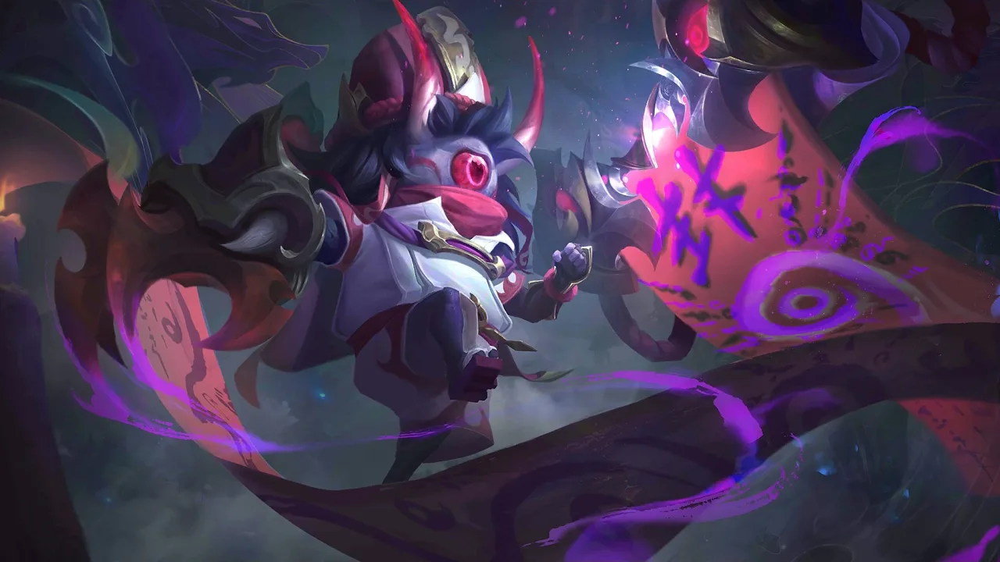

[Скины Циклопа](https://boostmlbb.ru/skins/cyclops.html)

[Скины](https://boostmlbb.ru/skins/)/[Циклоп](https://boostmlbb.ru/skins/cyclops.html)/Чернокнижник-ёкай

[Скин Циклопа](https://boostmlbb.ru/skins/cyclops.html)

# Чернокнижник-ёкай

Yokai Warlock

Изысканный ExquisiteКоллекционныйОграниченный

Как получить

Главный приз розыгрыша в коллекционном событии, попытки покупаются за алмазы. Ограниченные облики иногда возвращаются в розыгрышах событий.

Вышел

10 апреля 2023

## Что меняет облик

-   Новая внешность
-   Новые эффекты навыков
-   Звуки навыков
-   Своя озвучка
-   Анимация показа
-   Сцена показа
-   Музыка показа
-   Особые действия
-   Бонус к характеристикам

## Все скины Циклопа [9](https://boostmlbb.ru/skins/cyclops.html)

[Губка БобДелюкс · 2025](https://boostmlbb.ru/skins/cyclops/spongebob.html)[Чернок­нижник-ёкайИзысканный · 2023](https://boostmlbb.ru/skins/cyclops/yokai-warlock.html)[Соломенная куклаИсключительный · 2021](https://boostmlbb.ru/skins/cyclops/straw-doll.html)[Мастер ЙодаГрандиозный · 2021](https://boostmlbb.ru/skins/cyclops/master-yoda.html)[Глубоко­водный спасательИсключительный · 2018](https://boostmlbb.ru/skins/cyclops/deep-sea-rescuer.html)[Зомби-малышОбычный · 2018](https://boostmlbb.ru/skins/cyclops/zombie-bambino.html)[Каратель S.A.B.E.R.Делюкс · 2018](https://boostmlbb.ru/skins/cyclops/s-a-b-e-r-enforcer.html)[Супер-искатель приклю­ченийОбычный · 2017](https://boostmlbb.ru/skins/cyclops/super-adventurer.html)[ЭкзорцистОбычный · 2017](https://boostmlbb.ru/skins/cyclops/exorcist.html)

## Серия «Коллекционный»

[ОчистительБруно · 2026](https://boostmlbb.ru/skins/bruno/the-purifier.html)[Небесный бунтарьСан · 2026](https://boostmlbb.ru/skins/sun/celestial-rebel.html)[Кайдзю глубинХелкарт · 2026](https://boostmlbb.ru/skins/helcurt/kaiju-of-the-deep.html)[Звёздный дозорныйКимми · 2026](https://boostmlbb.ru/skins/kimmy/starbound-sentry.html)[Монархиня грёзАлиса · 2026](https://boostmlbb.ru/skins/alice/dreaming-monarch.html)[Дрожь глубинГрок · 2026](https://boostmlbb.ru/skins/grock/tremor-of-the-deep.html)[Небесный генералТигрил · 2026](https://boostmlbb.ru/skins/tigreal/celestial-general.html)[Монарх, рождённый солнцемКсавьер · 2026](https://boostmlbb.ru/skins/xavier/sunborn-monarch.html)

**Сколько стоит буст на герое Циклоп?**Выберите текущий и желаемый ранг. Стоимость появится на сайте.

[Рассчитать цену](https://boostmlbb.ru/order.html?type=hero)

## Частые вопросы

Как получить скин «Чернокнижник-ёкай» на Циклопа?

Главный приз розыгрыша в коллекционном событии, попытки покупаются за алмазы. Ограниченные облики иногда возвращаются в розыгрышах событий.

Когда вышел скин «Чернокнижник-ёкай»?

10 апреля 2023.

Какой класс у скина «Чернокнижник-ёкай»?

Изысканный (Exquisite), серия «Коллекционный».
