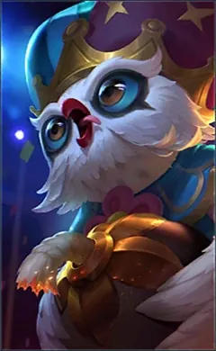

[Тир-лист](https://boostmlbb.ru/heroes/)[Предметы](https://boostmlbb.ru/items/)[Скины](https://boostmlbb.ru/skins/)[Новости и гайды](https://boostmlbb.ru/news/)

[Скины](https://boostmlbb.ru/skins/)/[Дигги](https://boostmlbb.ru/skins/diggie.html)/Цирковой клоун

[Скин Дигги](https://boostmlbb.ru/skins/diggie.html)

# Цирковой клоун

Circus Clown

Обычный CommonЭлитныйВ продаже

Как получить

Продаётся в магазине обликов за 599 алмазов.

Цена

599 алмазов

Вышел

9 октября 2021

## Что меняет облик

-   Новая внешность
-   Другой цвет эффектов
-   Анимация показа
-   Бонус к характеристикам

## Все скины Дигги [5](https://boostmlbb.ru/skins/diggie.html)

[Хранитель подлескаОбычный · 2024](https://boostmlbb.ru/skins/diggie/underwood-steward.html)[СказочникДелюкс · 2022](https://boostmlbb.ru/skins/diggie/fairytaler.html)[Цирковой клоунОбычный · 2021](https://boostmlbb.ru/skins/diggie/circus-clown.html)[СозвездиеИсключительный · 2019](https://boostmlbb.ru/skins/diggie/constellation.html)[ГолубятникОбычный · 2017](https://boostmlbb.ru/skins/diggie/pigeoneer.html)

## Серия «Элитный»

[Золотой османтусЧан'Э · 2026](https://boostmlbb.ru/skins/change/golden-osmanthus.html)[Король-воена­чальникМартис · 2025](https://boostmlbb.ru/skins/martis/warlord-king.html)[Кадет открытого моряКимми · 2024](https://boostmlbb.ru/skins/kimmy/high-seas-cadet.html)[Зелёная копейщицаСильвана · 2024](https://boostmlbb.ru/skins/silvanna/verdant-lancer.html)[Мародёр Кровавое КопытоХилос · 2024](https://boostmlbb.ru/skins/hylos/bloodhoof-marauder.html)[Изящная бабочкаГвиневра · 2024](https://boostmlbb.ru/skins/guinevere/elegant-butterfly.html)[Маркиз клинковЛанселот · 2024](https://boostmlbb.ru/skins/lancelot/marques-of-blades.html)[Привал в пустошахЧип · 2024](https://boostmlbb.ru/skins/chip/badlands-hiatus.html)

**Поднимем ранг на герое Дигги**Цена считается в калькуляторе

[Рассчитать цену](https://boostmlbb.ru/order.html?type=hero)

## Частые вопросы

Как получить скин «Цирковой клоун» на Дигги?

Продаётся в магазине обликов за 599 алмазов.

Когда вышел скин «Цирковой клоун»?

9 октября 2021.

Какой класс у скина «Цирковой клоун»?

Обычный (Common), серия «Элитный».
