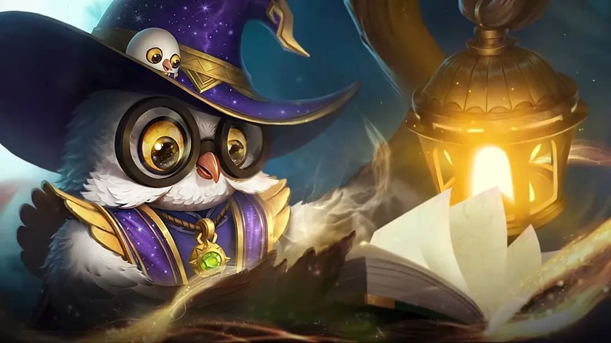

[Тир-лист](https://boostmlbb.ru/heroes/)[Предметы](https://boostmlbb.ru/items/)[Скины](https://boostmlbb.ru/skins/)[Новости и гайды](https://boostmlbb.ru/news/)

[Скины](https://boostmlbb.ru/skins/)/[Дигги](https://boostmlbb.ru/skins/diggie.html)/Созвездие

[Скин Дигги](https://boostmlbb.ru/skins/diggie.html)

# Созвездие

Constellation

Исключительный ExceptionalОсобыйВ продаже

Как получить

Продаётся в магазине обликов за 749 алмазов.

Цена

749 алмазов

Вышел

7 мая 2019

## Что меняет облик

-   Новая внешность
-   Новые эффекты навыков
-   Анимация показа
-   Бонус к характеристикам

## Перекраски

Тот же облик в других цветах. Перекраска открывается, только если у вас уже есть сам облик.

-   **Астролог** AstrologistНаграда «Звёздного участника» в июне 2021.

## Все скины Дигги [5](https://boostmlbb.ru/skins/diggie.html)

[Хранитель подлескаОбычный · 2024](https://boostmlbb.ru/skins/diggie/underwood-steward.html)[СказочникДелюкс · 2022](https://boostmlbb.ru/skins/diggie/fairytaler.html)[Цирковой клоунОбычный · 2021](https://boostmlbb.ru/skins/diggie/circus-clown.html)[СозвездиеИсключительный · 2019](https://boostmlbb.ru/skins/diggie/constellation.html)[ГолубятникОбычный · 2017](https://boostmlbb.ru/skins/diggie/pigeoneer.html)

## Серия «Особый»

[Тайный вердиктМатильда · 2026](https://boostmlbb.ru/skins/mathilda/arcane-verdict.html)[Вальс на ветруВэйл · 2026](https://boostmlbb.ru/skins/vale/windborne-waltz.html)[Капитан потерянныхФранко · 2026](https://boostmlbb.ru/skins/franco/captain-of-the-lost.html)[ВолнорезЛи Сун-Син · 2025](https://boostmlbb.ru/skins/yi-sun-shin/wavebreaker.html)[Стальные рукиБаданг · 2025](https://boostmlbb.ru/skins/badang/steel-arms.html)[Леди с зонтикомКагура · 2025](https://boostmlbb.ru/skins/kagura/lady-parasol.html)[Ужас пучиныАлдос · 2025](https://boostmlbb.ru/skins/aldous/fathom-terror.html)[Труппа лунного светаЧан'Э · 2025](https://boostmlbb.ru/skins/change/moonglow-troupe.html)

**Поднимем ранг на герое Дигги**Цена считается в калькуляторе

[Рассчитать цену](https://boostmlbb.ru/order.html?type=hero)

## Частые вопросы

Как получить скин «Созвездие» на Дигги?

Продаётся в магазине обликов за 749 алмазов.

Когда вышел скин «Созвездие»?

7 мая 2019.

Какой класс у скина «Созвездие»?

Исключительный (Exceptional), серия «Особый».
